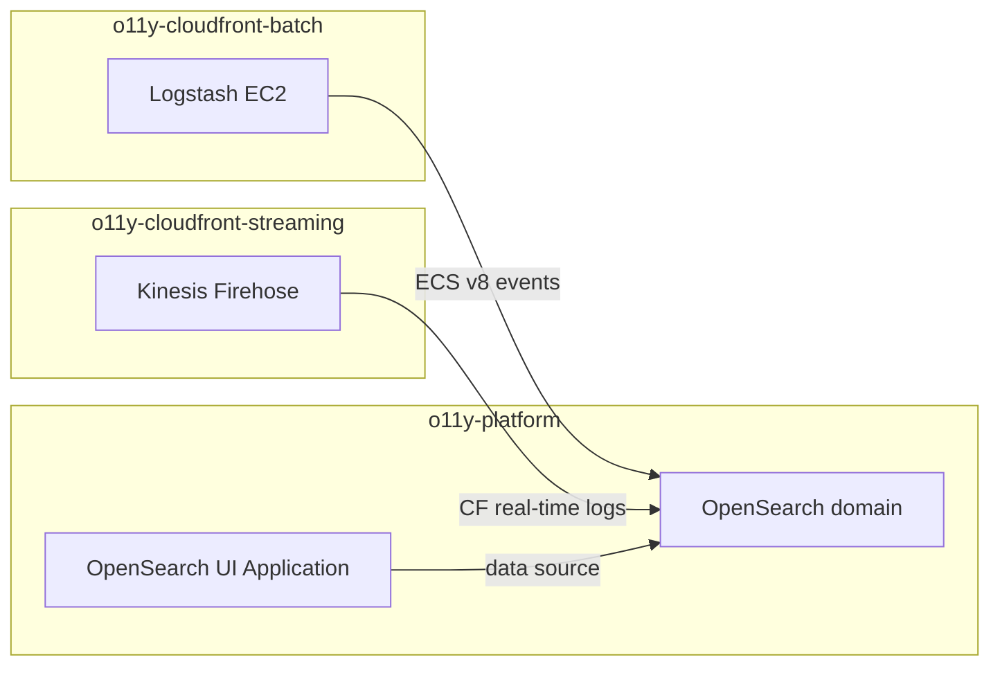

# Planetary Data Cloud (PDC) o11y-platform

Shared OpenSearch-backed observability platform for the Planetary Data Cloud. Aggregates logs from PDS services: batch node access logs via Logstash and CloudFront real-time logs via Kinesis Firehose.

## Architecture

Both consumers write to the shared domain and discover it through SSM. There is no shared Terraform state between repos.

## Components

| Component | Path | Description |
|---|---|---|
| OpenSearch domain | [`terraform/opensearch/`](terraform/opensearch/README.md) | Shared VPC-only OpenSearch cluster |
| OpenSearch UI Application | [`terraform/opensearch-ui/`](terraform/opensearch-ui/README.md) | AWS-hosted UI for ops access, with the domain as its data source |

## Consumers

| Repo | What it writes |
|---|---|
| [o11y-cloudfront-batch](https://github.com/NASA-PDS/o11y-cloudfront-batch) | Parsed PDS node access logs (ECS v8) |
| [o11y-cloudfront-streaming](https://github.com/NASA-PDS/o11y-cloudfront-streaming) | CloudFront real-time log stream |

## Documentation map

Each topic has one home. Other docs link to it instead of repeating it. All deployments are driven by Terragrunt from `cds-infra-deploy`; start at [Initial deployment](terraform/README.md#initial-deployment).

| Topic | Home |
|---|---|
| Deployment order, permission tiers, SSM contract, updating, testing, teardown | [Deployment runbook](terraform/README.md) |
| OpenSearch domain inputs, engine and node upgrades | [`terraform/opensearch/README.md`](terraform/opensearch/README.md) |
| OpenSearch UI Application inputs | [`terraform/opensearch-ui/README.md`](terraform/opensearch-ui/README.md) |
| Batch `iam`, `s3`, `logstash` modules | [o11y-cloudfront-batch `terraform/README.md`](https://github.com/NASA-PDS/o11y-cloudfront-batch/blob/main/terraform/README.md) |
| Operating and troubleshooting Logstash | [o11y-cloudfront-batch Operations Runbook](https://github.com/NASA-PDS/o11y-cloudfront-batch/blob/main/docs/operations.md) |
| Logstash pipeline tests | [o11y-cloudfront-batch `tests/README.md`](https://github.com/NASA-PDS/o11y-cloudfront-batch/blob/main/tests/README.md) |
| Streaming `iam/` and `streaming/` modules | [o11y-cloudfront-streaming `terraform/README.md`](https://github.com/NASA-PDS/o11y-cloudfront-streaming/blob/main/terraform/README.md) |
| CloudFront distribution and the o11y integration flags | [pdc-cds-infra `cloudfront/pds-main`](https://github.com/NASA-PDS/pdc-cds-infra/blob/main/terraform/cloudfront/pds-main/README.md#o11y-integration) |
| Shared EC2, S3, and IAM Terraform modules | [pdc-tf-modules](https://github.com/NASA-PDS/pdc-tf-modules) |
