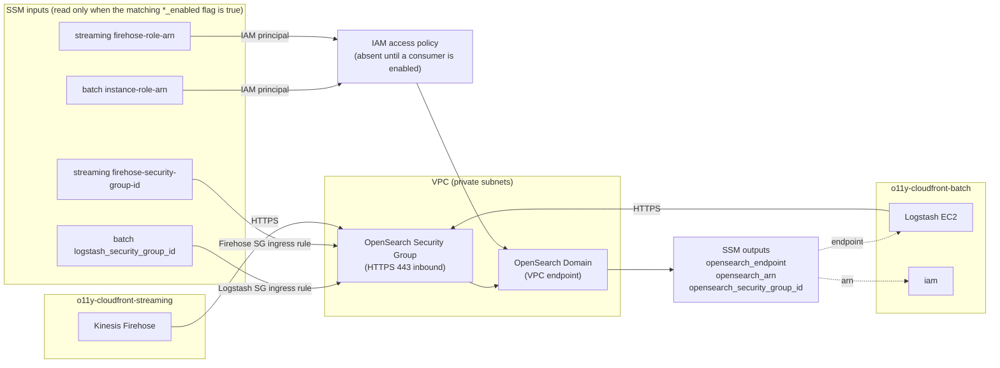
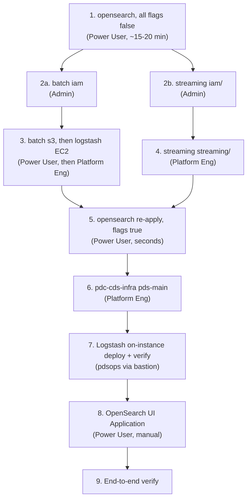

# PDS o11y-platform - Deployment Runbook

This is the single runbook for deploying, updating, and testing the PDS observability stack: the shared OpenSearch domain in this repo plus its two consumers, [o11y-cloudfront-batch](https://github.com/NASA-PDS/o11y-cloudfront-batch) and [o11y-cloudfront-streaming](https://github.com/NASA-PDS/o11y-cloudfront-streaming), and the CloudFront wiring in [pdc-cds-infra](https://github.com/NASA-PDS/pdc-cds-infra).

Each component repo documents its own modules (inputs, apply, verify, update). This runbook owns the **order** of phases, the **permissions** each needs, and the **cross-repo SSM contract**. It links to the component docs instead of repeating them.

| I want to... | Go to |
|---|---|
| Deploy a venue from scratch | [Initial deployment](#initial-deployment) |
| Change an already-deployed component | [Updating](#updating) |
| Check that a deployment works | [Testing](#testing) |
| See which SSM parameters connect the repos | [SSM contract](#ssm-contract) |

## Architecture



- **Network:** the domain is VPC-only. Security group ingress rules (port 443) for Logstash and Firehose live in this module. Each consumer's security group ID is read from SSM at plan time.
- **API:** an IAM resource-based policy allows the consumer role ARNs, read from SSM at plan time.
- **Gating:** both are controlled by `o11y_cloudfront_batch_enabled` and `o11y_cloudfront_streaming_enabled`, so the domain can bootstrap before any consumer exists.
- **Discovery:** consumers read the domain's SSM outputs at plan time. There is no shared Terraform state between repos.
- **Ops access:** the AWS-hosted [OpenSearch UI Application](#phase-8---opensearch-ui-application), not the built-in `/_dashboards` endpoint.

## Prerequisites

Tools: [Terraform](https://developer.hashicorp.com/terraform/downloads) >= 1.10.0, [Terragrunt](https://terragrunt.gruntwork.io/docs/getting-started/install/) >= 0.55, [Task](https://taskfile.dev) (`brew install go-task/tap/go-task`), and the AWS CLI.

Checkouts: `cds-infra-deploy` (all venue inputs live there as `venues/<venue>/<repo>/<module>/terragrunt.hcl`), this repo (for `scripts/smoke-test.sh`), and `o11y-cloudfront-streaming` (for its Kinesis smoke test in Phase 6).

Gather these values before Phase 1. Every phase opens with a **Setup** block that assigns the ones it uses, so you can run any phase in a new shell. Edit the values in each Setup block before you run it.

| Variable | Meaning | Value |
|---|---|---|
| `VENUE` | Venue to deploy | `dev`, `test`, or `prod` |
| `REGION` | AWS region of the venue | `us-west-2` in the examples; use the region in the venue's `cds-infra-deploy` inputs |
| `PROFILE_NAME` | AWS CLI profile for the phase's permission tier | Your profile for that tier; see [Required AWS permissions](#required-aws-permissions) |
| `CDS_INFRA_DEPLOY_DIR` | Local `cds-infra-deploy` checkout | The path to your clone |
| `O11Y_PLATFORM_DIR` | Local `o11y-platform` checkout | The path to your clone |
| `O11Y_STREAMING_DIR` | Local `o11y-cloudfront-streaming` checkout | The path to your clone |

Terraform's S3 backend needs exported credentials with `AWS_PROFILE` unset. Each Setup block does this with `aws configure export-credentials`. Credentials expire after about an hour; re-run the Setup block if a command reports expired credentials.

## Required AWS permissions

A principal needs the highest tier of every module it deploys.

| Tier | Who | Required when |
|---|---|---|
| **Admin** | Ops/Admin SSO role with `iam:CreateRole` | Any IAM *creation* module: the `iam` modules in the consumer repos |
| **Platform Engineer** | SSO role with `iam:PassRole` (not `CreateRole`) | Any module that assigns an existing role ARN to a non-IAM resource: Firehose, Lambda, EC2 instance profile, CloudFront real-time log config |
| **Power User** | Standard `Project-Power-User` SSO | Everything else: OpenSearch bootstrap, S3, Kinesis, CloudWatch, SSM reads |

`iam:PassRole` is not `iam:CreateRole`. A module that only reads a role ARN from SSM and assigns it to a service resource is Platform Engineer, not Admin.

## SSM contract

Parameters that cross a repo boundary. Each repo publishes what the next phase reads, and consumers read them at plan time. Parameters used inside a single component are documented in that component's README.

| Parameter path | Published by (phase) | Read by | Read when |
|---|---|---|---|
| `/pds/o11y-platform/opensearch/opensearch_endpoint` | platform `opensearch` (1) | batch `logstash` | always |
| `/pds/o11y-platform/opensearch/opensearch_arn` | platform `opensearch` (1) | batch `iam` | always |
| `/pds/o11y-platform/opensearch/opensearch_security_group_id` | platform `opensearch` (1), when `vpc_enabled` | `scripts/smoke-test.sh` | - |
| `/pds/o11y-cloudfront-batch/iam/roles/ec2/instance-role-arn` | batch `iam` (2a) | platform `opensearch`; `pds-main` | `o11y_cloudfront_batch_enabled`; `enable_o11y_batch` |
| `/pds/o11y-cloudfront-batch/ec2/logstash_security_group_id` | batch `logstash` (3) | platform `opensearch` | `o11y_cloudfront_batch_enabled` and `vpc_enabled` |
| `/pds/o11y-cloudfront-streaming/firehose/firehose-role-arn` | streaming `iam/` (2b) | platform `opensearch`; `pds-main` | `o11y_cloudfront_streaming_enabled`; `enable_o11y_streaming` |
| `/pds/o11y-cloudfront-streaming/firehose/firehose-security-group-id` | streaming `streaming/` (4) | platform `opensearch` | `o11y_cloudfront_streaming_enabled` and `vpc_enabled` |
| `/pds/o11y-cloudfront-streaming/cloudfront/cloudfront-role-arn` | streaming `iam/` (2b) | `pds-main` | `enable_o11y_streaming` |
| `/pds/o11y-cloudfront-streaming/kinesis/kinesis-stream-arn` | streaming `iam/` (2b); the ARN is computed, the stream is created in phase 4 | `pds-main` | `enable_o11y_streaming` |
| `/pds/pdc-cds-infra/s3/pds-logs-bucket-arn` | `pds-main` (6); seeded by hand before phase 2b on a first deploy | streaming `iam/` and `streaming/` | always |

Streaming looks up the OpenSearch domain by name, not through SSM.

## Deployment flow

> **`opensearch` is always applied twice.** Phase 1 creates the domain with every `*_enabled` flag `false`, because the consumers don't exist yet. Phase 5 sets the flags to `true` after the consumers have published their SSM parameters. Phase 5 is an access-policy and ingress-rule update only; the domain is not redeployed.
>
> Enabling a flag before its parameters exist fails the plan with a missing-parameter error. That error means an earlier phase is incomplete.
>
> | Flag | Phases that must already be applied |
> |---|---|
> | `o11y_cloudfront_batch_enabled` | batch `iam` (2a) and `logstash` (3) |
> | `o11y_cloudfront_streaming_enabled` | streaming `iam/` (2b) and `streaming/` (4) |
>
> Until a flag is on, that consumer has no access-policy entry and no ingress rule, so it cannot reach the domain.



Phase 6 runs last, after every component it points at exists. See [Phase 6](#phase-6---cloudfront-pds-main) for why.

## Initial deployment

Complete the phases in order. Run each Verify step and get the expected result before moving on. Three phases end with a smoke test: Phase 1 (OpenSearch domain), Phase 6 (streaming), and Phase 7 (Logstash). [Testing](#testing) lists when to run each. Each phase starts with a Setup block: edit its values, then run it. It sets the variables the phase uses, exports credentials for the phase's permission tier, and changes into the directory the commands run from.

### Phase 1 - Bootstrap OpenSearch

**Tier:** Power User. **Time:** about 15-20 minutes.

Creates the VPC-only domain and its security group, and publishes the endpoint, ARN, and security group ID to SSM. No consumer is enabled. Venue inputs are in `venues/<venue>/o11y-platform/opensearch/terragrunt.hcl`; the inputs shape is in the [opensearch module README](opensearch/README.md#deploy).

**Setup**

```bash
VENUE="dev"                                       # dev | test | prod
REGION="us-west-2"
PROFILE_NAME="<aws-profile-name>"
CDS_INFRA_DEPLOY_DIR="<path-to-cds-infra-deploy-checkout>"
O11Y_PLATFORM_DIR="<path-to-o11y-platform-checkout>"

eval $(aws configure export-credentials --profile "${PROFILE_NAME}" --format env)
unset AWS_PROFILE
export AWS_DEFAULT_REGION="${REGION}"
cd "${CDS_INFRA_DEPLOY_DIR}"
```

**Steps**

1. Confirm both consumer flags are `false` or unset:

   ```bash
   grep -nE 'o11y_cloudfront_(batch|streaming)_enabled' \
     "venues/${VENUE}/o11y-platform/opensearch/terragrunt.hcl"
   ```

2. Plan and apply:

   ```bash
   task plan  VENUE="${VENUE}" COMPONENT=o11y-platform/opensearch
   task apply VENUE="${VENUE}" COMPONENT=o11y-platform/opensearch
   ```

**Verify - OpenSearch smoke test**

Run it from your workstation after the apply finishes:

```bash
bash "${O11Y_PLATFORM_DIR}/scripts/smoke-test.sh" "${VENUE}"
```

Expected: `All 7 check(s) passed.` The script checks the three SSM parameters, the security group, domain status, and cluster health (Green or Yellow). If a check fails, wait for the domain to leave `Processing` and re-run; if an SSM parameter is missing, the apply did not complete.

### Phase 2 - IAM

**Tier:** Admin. Phases 2a and 2b are independent and can run in either order.

Each consumer's `iam` module creates its roles and publishes their ARNs to SSM. Module details: [batch `iam`](https://github.com/NASA-PDS/o11y-cloudfront-batch/blob/main/terraform/README.md), [streaming `iam/`](https://github.com/NASA-PDS/o11y-cloudfront-streaming/blob/main/terraform/iam/README.md).

**Setup** (both 2a and 2b)

```bash
VENUE="dev"                                       # dev | test | prod
REGION="us-west-2"
PROFILE_NAME="<aws-profile-name>"
CDS_INFRA_DEPLOY_DIR="<path-to-cds-infra-deploy-checkout>"

eval $(aws configure export-credentials --profile "${PROFILE_NAME}" --format env)
unset AWS_PROFILE
export AWS_DEFAULT_REGION="${REGION}"
cd "${CDS_INFRA_DEPLOY_DIR}"
```

**2a - o11y-cloudfront-batch**

```bash
task plan  VENUE="${VENUE}" COMPONENT=o11y-cloudfront-batch/iam
task apply VENUE="${VENUE}" COMPONENT=o11y-cloudfront-batch/iam
```

Verify:

```bash
aws ssm get-parameter --region "${REGION}" \
  --name /pds/o11y-cloudfront-batch/iam/roles/ec2/instance-role-arn \
  --query Parameter.Value --output text
```

Expected: an IAM role ARN. `ParameterNotFound` means the apply did not complete.

**2b - o11y-cloudfront-streaming**

1. On a first deploy only, confirm the logs bucket ARN parameter exists. Streaming `iam/` reads it.

   ```bash
   aws ssm get-parameter --region "${REGION}" \
     --name /pds/pdc-cds-infra/s3/pds-logs-bucket-arn \
     --query Parameter.Value --output text
   ```

   Expected: `arn:aws:s3:::pds-logs-<venue>`. If the result is `ParameterNotFound`, seed it once. Phase 6 takes the parameter over without an import.

   ```bash
   aws ssm put-parameter \
     --region "${REGION}" \
     --name /pds/pdc-cds-infra/s3/pds-logs-bucket-arn \
     --value "arn:aws:s3:::pds-logs-${VENUE}" \
     --type String
   ```

2. Plan and apply:

   ```bash
   task plan  VENUE="${VENUE}" COMPONENT=o11y-cloudfront-streaming/iam
   task apply VENUE="${VENUE}" COMPONENT=o11y-cloudfront-streaming/iam
   ```

Verify:

```bash
for P in cloudfront/cloudfront-role-arn firehose/firehose-role-arn kinesis/kinesis-stream-arn; do
  aws ssm get-parameter --region "${REGION}" \
    --name "/pds/o11y-cloudfront-streaming/${P}" \
    --query Parameter.Value --output text
done
```

Expected: three ARNs. The Kinesis ARN is computed; the stream itself does not exist until Phase 4. Do not deploy `streaming/` yet.

### Phase 3 - Batch S3 and Logstash EC2

**Tier:** Power User for `s3` (3a), Platform Engineer for `logstash` (3b, `iam:PassRole` to the EC2 instance profile). Needs Phases 1 and 2a.

`s3` creates the bucket that receives PDS node access logs. `logstash` creates the EC2 instance and its security group, and publishes the security group ID. This phase creates the instance only; Logstash is installed in Phase 7.

**Setup**

```bash
VENUE="dev"                                       # dev | test | prod
REGION="us-west-2"
PROFILE_NAME="<aws-profile-name>"
CDS_INFRA_DEPLOY_DIR="<path-to-cds-infra-deploy-checkout>"

eval $(aws configure export-credentials --profile "${PROFILE_NAME}" --format env)
unset AWS_PROFILE
export AWS_DEFAULT_REGION="${REGION}"
cd "${CDS_INFRA_DEPLOY_DIR}"
```

**3a - s3**

```bash
task plan  VENUE="${VENUE}" COMPONENT=o11y-cloudfront-batch/s3
task apply VENUE="${VENUE}" COMPONENT=o11y-cloudfront-batch/s3
```

**3b - logstash**

```bash
task plan  VENUE="${VENUE}" COMPONENT=o11y-cloudfront-batch/logstash
task apply VENUE="${VENUE}" COMPONENT=o11y-cloudfront-batch/logstash
```

**Verify**

```bash
aws ssm get-parameter --region "${REGION}" \
  --name /pds/o11y-cloudfront-batch/s3/bucket_name \
  --query Parameter.Value --output text
aws ssm get-parameter --region "${REGION}" \
  --name /pds/o11y-cloudfront-batch/ec2/logstash_security_group_id \
  --query Parameter.Value --output text
```

Expected: a bucket name and a `sg-` ID. Module details: [batch Terraform README](https://github.com/NASA-PDS/o11y-cloudfront-batch/blob/main/terraform/README.md).

### Phase 4 - Streaming

**Tier:** Platform Engineer (`iam:PassRole` to Firehose and Lambda). Needs Phases 1 and 2b.

Creates the Kinesis stream, Lambda transform, Firehose delivery stream, and the Firehose security group. The apply succeeds before OpenSearch access is granted, but Firehose cannot write to the domain until Phase 5.

```bash
VENUE="dev"                                       # dev | test | prod
REGION="us-west-2"
PROFILE_NAME="<aws-profile-name>"
CDS_INFRA_DEPLOY_DIR="<path-to-cds-infra-deploy-checkout>"

eval $(aws configure export-credentials --profile "${PROFILE_NAME}" --format env)
unset AWS_PROFILE
export AWS_DEFAULT_REGION="${REGION}"
cd "${CDS_INFRA_DEPLOY_DIR}"
```

**Steps**

```bash
VENUE="dev"
task plan  VENUE="${VENUE}" COMPONENT=o11y-cloudfront-streaming/streaming
task apply VENUE="${VENUE}" COMPONENT=o11y-cloudfront-streaming/streaming
```

**Verify**

```bash
aws ssm get-parameter --region "${REGION}" \
  --name /pds/o11y-cloudfront-streaming/firehose/firehose-security-group-id \
  --query Parameter.Value --output text

aws kinesis describe-stream-summary --region "${REGION}" \
  --stream-name pds-o11y-cloudfront-streaming-kinesis \
  --query StreamDescriptionSummary.StreamStatus --output text
```

Expected: a `sg-` ID and `ACTIVE`. Module details: [streaming Terraform README](https://github.com/NASA-PDS/o11y-cloudfront-streaming/blob/main/terraform/README.md).

### Phase 5 - Grant consumers OpenSearch access

**Tier:** Power User. **Time:** seconds. Needs Phases 2a, 2b, 3, and 4.

The second `opensearch` apply. It adds both consumer role ARNs to the access policy and both security groups to the ingress rules.

**Setup**

```bash
VENUE="dev"                                       # dev | test | prod
REGION="us-west-2"
PROFILE_NAME="<aws-profile-name>"
CDS_INFRA_DEPLOY_DIR="<path-to-cds-infra-deploy-checkout>"

eval $(aws configure export-credentials --profile "${PROFILE_NAME}" --format env)
unset AWS_PROFILE
export AWS_DEFAULT_REGION="${REGION}"
cd "${CDS_INFRA_DEPLOY_DIR}"
```

**Steps**

1. Set both flags to `true` in `venues/<venue>/o11y-platform/opensearch/terragrunt.hcl` in `cds-infra-deploy`:

   ```hcl
   o11y_cloudfront_batch_enabled     = true
   o11y_cloudfront_streaming_enabled = true
   ```

   Confirm the edit:

   ```bash
   grep -nE 'o11y_cloudfront_(batch|streaming)_enabled' \
     "venues/${VENUE}/o11y-platform/opensearch/terragrunt.hcl"
   ```

   Expected: both lines end in `true`.

2. Plan, and confirm the plan only changes the access policy and adds two ingress rules. It must not replace `aws_opensearch_domain.this`. Then apply:

   ```bash
   task plan  VENUE="${VENUE}" COMPONENT=o11y-platform/opensearch
   task apply VENUE="${VENUE}" COMPONENT=o11y-platform/opensearch
   ```

**Verify**

```bash
DOMAIN_NAME=$(aws ssm get-parameter --region "${REGION}" \
  --name /pds/o11y-platform/opensearch/opensearch_arn \
  --query Parameter.Value --output text | awk -F/ '{print $NF}')
aws opensearch describe-domain --region "${REGION}" --domain-name "${DOMAIN_NAME}" \
  --query 'DomainStatus.AccessPolicies' --output text

OS_SG_ID=$(aws ssm get-parameter --region "${REGION}" \
  --name /pds/o11y-platform/opensearch/opensearch_security_group_id \
  --query Parameter.Value --output text)
aws ec2 describe-security-group-rules --region "${REGION}" \
  --filters "Name=group-id,Values=${OS_SG_ID}" \
  --query 'SecurityGroupRules[?IsEgress==`false`].[ReferencedGroupInfo.GroupId,FromPort]' \
  --output text
```

Expected: the access policy lists both role ARNs (the batch `instance-role-arn` and the streaming `firehose-role-arn`). The ingress rules show two rows on port `443`, one for the Logstash security group and one for the Firehose security group.

### Phase 6 - CloudFront (`pds-main`)

**Tier:** Platform Engineer (`iam:PassRole` for the CloudFront real-time log config). Needs Phases 2a, 2b, 4, and 5.

Applies `cloudfront/pds-main` from [pdc-cds-infra](https://github.com/NASA-PDS/pdc-cds-infra) with both o11y flags on. It:

- creates the CloudFront real-time log config that sends records to the Kinesis stream (`enable_o11y_streaming`);
- adds bucket policy statements on `pds-logs-<venue>`: `AllowO11yBatchLogstashRead` lets the Logstash role read the CloudFront access-log prefix (`enable_o11y_batch`), and `AllowFirehoseWrite` lets Firehose write its S3 backup (`enable_o11y_streaming`);
- manages `/pds/pdc-cds-infra/s3/pds-logs-bucket-arn`.

**Why this phase is last before the Logstash deploy:** it points the shared CloudFront distribution at the Kinesis stream and opens the logs bucket to Logstash. Running it after Phases 4 and 5 means the stream exists, OpenSearch already accepts both consumers, and a failure is easy to back out by setting both flags to `false`. See the pdc-cds-infra [o11y integration](https://github.com/NASA-PDS/pdc-cds-infra/blob/main/terraform/cloudfront/pds-main/README.md#o11y-integration) section for the module inputs.

`enable_o11y_batch` is needed only if Logstash ingests CloudFront logs from `pds-logs-<venue>` (`S3_CF_BUCKET_NAME` is set in the Logstash environment).

**Setup**

```bash
VENUE="dev"                                       # dev | test | prod
REGION="us-west-2"
PROFILE_NAME="<platform-engineer-sso-profile>"
CDS_INFRA_DEPLOY_DIR="<path-to-cds-infra-deploy-checkout>"
O11Y_STREAMING_DIR="<path-to-o11y-cloudfront-streaming-checkout>"

eval $(aws configure export-credentials --profile "${PROFILE_NAME}" --format env)
unset AWS_PROFILE
export AWS_DEFAULT_REGION="${REGION}"
cd "${CDS_INFRA_DEPLOY_DIR}"
```

**Steps**

1. Confirm both flags are `true`. The module default is `true`; check the venue file for an override.

   ```bash
   grep -nE 'enable_o11y_(batch|streaming)' \
     "venues/${VENUE}/pdc-cds-infra/cloudfront/pds-main/terragrunt.hcl"
   ```

2. Plan and apply:

   ```bash
   task plan  VENUE="${VENUE}" COMPONENT=pdc-cds-infra/cloudfront/pds-main
   task apply VENUE="${VENUE}" COMPONENT=pdc-cds-infra/cloudfront/pds-main
   ```

**Verify**

```bash
aws cloudfront list-realtime-log-configs \
  --query 'RealtimeLogConfigs.Items[].Name' --output text

aws s3api get-bucket-policy --bucket "pds-logs-${VENUE}" \
  --query Policy --output text
```

Expected: `pds-cloudfront-realtime-log-config` is listed, and the bucket policy contains the Sids `AllowO11yBatchLogstashRead` and `AllowFirehoseWrite`. The second command needs `s3:GetBucketPolicy`. Allow several minutes for the distribution to finish deploying before expecting records.

**Verify - streaming smoke test**

Run it from your workstation once the distribution has finished deploying (several minutes after the apply). It needs Phase 4 (the Kinesis stream) and this phase (the log config), and it sends its own test requests:

```bash
bash "${O11Y_STREAMING_DIR}/scripts/smoke-test-realtime-stream.sh" "${VENUE}"
```

Expected: `PASS: <n> record(s) reached the Kinesis stream`, within about 3 minutes. The script requests a few URLs under `/data` and polls the stream's `IncomingRecords` metric. On `FAIL`, the distribution may still be deploying; wait and re-run. This test stops at Kinesis. It does not check that Firehose delivered to OpenSearch (the domain is VPC-only), so that check is [Phase 9](#phase-9---end-to-end-verify).

### Phase 7 - Deploy Logstash and verify

**Tier:** shell access to the EC2 as `pdsops`, through the bastion. Needs Phases 3 and 5. It also needs Phase 6 if Logstash ingests CloudFront logs (`S3_CF_BUCKET_NAME` set).

Installs and starts Logstash on the instance created in Phase 3. This runs on the instance, not through Terragrunt, so it has no Setup block here: each batch procedure below sets the variables it uses (`S3_CF_BUCKET_NAME`, `REPO_BRANCH`, and the optional ones). The batch repo owns these steps; do not copy them here.

**Steps** (on the instance, as `pdsops`)

1. Reach the instance: [Access model](https://github.com/NASA-PDS/o11y-cloudfront-batch/blob/main/terraform/logstash/README.md#access-model).
2. Deploy Logstash: [First-boot setup](https://github.com/NASA-PDS/o11y-cloudfront-batch/blob/main/terraform/logstash/README.md#first-boot-setup). Its last step confirms the service is `active`.

**Verify - Logstash smoke test**

Run it on the instance after the deploy in step 2. Phase 5 must already be applied, because the test sends a signed request to OpenSearch:

```bash
bash /opt/o11y-cloudfront-batch/scripts/smoke-test.sh
```

Expected: exit code 0 and `PASS` on every check (Logstash install, linger, deployed pipeline configs, access to the batch log bucket, OpenSearch reachability and SigV4 auth, service state). OpenSearch status `green` is expected; `yellow` is acceptable on a single-node dev cluster.

A `FAIL` here is a real fault. An OpenSearch timeout or 403 means the Phase 5 access policy or ingress rule is not in effect. A failure on the bucket check points at the Phase 3 `s3` bucket or the Phase 2a IAM policy. This smoke test does not read the CloudFront logs bucket, so it does not exercise Phase 6; the CloudFront input is checked by the data-flow step in [Verify the deployment](https://github.com/NASA-PDS/o11y-cloudfront-batch/blob/main/terraform/logstash/README.md#verify-the-deployment) and by [Phase 9](#phase-9---end-to-end-verify). Troubleshooting: the batch [Operations Runbook](https://github.com/NASA-PDS/o11y-cloudfront-batch/blob/main/docs/operations.md#troubleshooting).

The full check list, including the bootstrap and data-flow checks, is [Verify the deployment](https://github.com/NASA-PDS/o11y-cloudfront-batch/blob/main/terraform/logstash/README.md#verify-the-deployment).

### Phase 8 - OpenSearch UI Application

**Tier:** Power User. All steps are manual (console and CLI).

The OpenSearch UI Application is an AWS-hosted web UI that reaches the VPC-only domain without a public endpoint. IAM Identity Center is not enabled in PDS accounts, so it uses IAM auth: IAM role ARNs are granted directly as admins. No Terraform resource exists yet ([hashicorp/terraform-provider-aws#45082](https://github.com/hashicorp/terraform-provider-aws/issues/45082)).

**Setup**

```bash
VENUE="dev"                                       # dev | test | prod
REGION="us-west-2"
PROFILE_NAME="<power-user-sso-profile>"
CDS_INFRA_DEPLOY_DIR="<path-to-cds-infra-deploy-checkout>"

eval $(aws configure export-credentials --profile "${PROFILE_NAME}" --format env)
unset AWS_PROFILE
export AWS_DEFAULT_REGION="${REGION}"

# The domain name is the last segment of the domain ARN published in SSM.
DOMAIN_NAME=$(aws ssm get-parameter --region "${REGION}" \
  --name /pds/o11y-platform/opensearch/opensearch_arn \
  --query Parameter.Value --output text | awk -F/ '{print $NF}')
echo "${DOMAIN_NAME}"
```

Expected: the domain name (for example `pds-<venue>-o11y`).

**Step 1 - Authorize VPC access (once per domain).** The AWS console features for a VPC domain, including the Indexes tab, cannot reach it until the `application.opensearchservice.amazonaws.com` service principal is authorized. The Terraform provider cannot express this ([hashicorp/terraform-provider-aws#41879](https://github.com/hashicorp/terraform-provider-aws/issues/41879)).

```bash
aws opensearch authorize-vpc-endpoint-access --region "${REGION}" \
  --domain-name "${DOMAIN_NAME}" \
  --service application.opensearchservice.amazonaws.com

aws opensearch list-vpc-endpoint-access --region "${REGION}" \
  --domain-name "${DOMAIN_NAME}"
```

Expected: the second command lists `application.opensearchservice.amazonaws.com`.

**Step 2 - Create the application (console).**

1. Open **Amazon OpenSearch Service > OpenSearch UI (Dashboards) > Create application**.
2. Set **Application name** to `pds-<venue>-o11y-ui`.
3. Leave **Authentication with IAM Identity Center** unchecked.
4. Under **OpenSearch application admins**, choose **Grant administrator's permission to specific user(s)**, select **IAM users**, and add the ops IAM role ARN(s).
5. Choose **Create**.

**Step 3 - Associate the domain.** On the application page choose **Manage data sources**, select the domain (the value printed by the Setup block), then **Next > Save**. **Launch Application** becomes active once a data source is associated.

**Verify:** launch the application, open **Dev Tools**, and run:

```text
GET _cluster/health
```

Expected: `"status"` is `green` or `yellow`. A 403 means the role you are using is not allowed on the domain; grant it in Step 4.

**Step 4 - Grant ops roles domain access (only if Verify returns 403).** With IAM auth the application passes the caller's IAM identity to the domain, so each operator role must be allowed on the domain.

1. Build the role ARN. The account ID comes from your current credentials; set the role name to the operator role that got the 403:

   ```bash
   OPS_ROLE_NAME="<ops-role-name>"
   ACCOUNT_ID=$(aws sts get-caller-identity --query Account --output text)
   echo "ops_role_arns = [\"arn:aws:iam::${ACCOUNT_ID}:role/${OPS_ROLE_NAME}\"]"
   ```

2. Add the printed line to the `inputs` block in `${CDS_INFRA_DEPLOY_DIR}/venues/${VENUE}/o11y-platform/opensearch/terragrunt.hcl`. For more than one role, list the ARNs in the same array.

   Use the IAM role ARN, as printed. An `arn:...:sts::...:assumed-role/...` ARN fails the plan with `Invalid value for variable "ops_role_arns"`, because it does not match the role's sessions.

3. Plan and apply:

   ```bash
   cd "${CDS_INFRA_DEPLOY_DIR}"
   task plan  VENUE="${VENUE}" COMPONENT=o11y-platform/opensearch
   task apply VENUE="${VENUE}" COMPONENT=o11y-platform/opensearch
   ```

4. Re-run the Verify command above.

Each listed role gets `es:ESHttp*` on the domain and all paths under it: every HTTP method on every index. This is the same access the consumer roles have. Fine-grained access control is off, so there is no read-only or per-index tier. Control-plane actions such as `es:DeleteDomain` are not granted.

### Phase 9 - End-to-end verify

**Tier:** the ops role from Phase 8. This phase uses the OpenSearch UI only, so it has no Setup block.

Confirms both pipelines are delivering documents. Generate traffic first: request a few URLs under `/data` through the CloudFront distribution. The real-time log config is attached to the `/data*` and `/data/store/img*` cache behaviors.

In OpenSearch UI **Dev Tools**:

```text
GET _cat/indices?v
```

Expected: the streaming index appears within minutes of traffic. The batch index appears after Logstash processes the next delivered log files.

| Pipeline | Index | Check |
|---|---|---|
| Streaming | `pds-o11y-cloudfront-streaming-index*` (one per day) | `docs.count` grows when you re-run the command |
| Batch | `<INDEX_PREFIX>-YYYY-MM` (one per month; the prefix is set in the Logstash environment) | `docs.count` is greater than 0 |

If an index is missing, find the failing hop:

| Missing | Check | Where |
|---|---|---|
| Streaming index | Real-time log config attached and distribution deployed (Phase 6); Firehose delivery errors | [streaming Terraform README](https://github.com/NASA-PDS/o11y-cloudfront-streaming/blob/main/terraform/README.md#troubleshooting) |
| Batch index | Logstash service, pipeline stats, bad-log file | batch [Operations Runbook](https://github.com/NASA-PDS/o11y-cloudfront-batch/blob/main/docs/operations.md#monitoring) |

## Updating

Re-run only the affected phase. Each component README owns the procedure for its own change; this table only says where to look.

| Change | Procedure | Notes |
|---|---|---|
| OpenSearch engine version, node count, instance type | [opensearch README: Upgrade](opensearch/README.md#upgrade) | Engine upgrade is a blue/green update, about 30 minutes in `Processing` |
| Consumer role or security group recreated | Re-run [Phase 5](#phase-5---grant-consumers-opensearch-access) | The SSM value changes, so the access policy and ingress rule must follow |
| Operator roles with domain access | Edit `ops_role_arns`, then [Phase 8, Step 4](#phase-8---opensearch-ui-application) | Access-policy update only |
| Batch IAM, S3, or Logstash instance | [batch Terraform README](https://github.com/NASA-PDS/o11y-cloudfront-batch/blob/main/terraform/README.md) (each module has an Update note) | A `logstash_version` change replaces the instance |
| Logstash pipeline config or `regexes.yaml` | batch [Update pipeline configuration](https://github.com/NASA-PDS/o11y-cloudfront-batch/blob/main/docs/operations.md#update-pipeline-configuration) | No Terraform change. Test first with the [pipeline tests](https://github.com/NASA-PDS/o11y-cloudfront-batch/blob/main/tests/README.md#running-the-integration-tests-with-docker) |
| Streaming Lambda, Kinesis, Firehose, or IAM | [streaming Terraform README: Updating](https://github.com/NASA-PDS/o11y-cloudfront-streaming/blob/main/terraform/README.md#updating) | |
| CloudFront log wiring or bucket access | pdc-cds-infra [`pds-main` README](https://github.com/NASA-PDS/pdc-cds-infra/blob/main/terraform/cloudfront/pds-main/README.md#o11y-integration) | |
| EC2, S3, or IAM module version | [pdc-tf-modules](https://github.com/NASA-PDS/pdc-tf-modules) | Update the module reference in the consuming component, then re-run its phase |

## Testing

### Smoke tests

Run each smoke test in its phase of the initial deployment, and again after any change to the part of the stack it covers.

| Smoke test | Command | Run from | Run it | It checks |
|---|---|---|---|---|
| OpenSearch domain | `scripts/smoke-test.sh <venue>` in this repo | Your workstation | [Phase 1](#phase-1---bootstrap-opensearch), after the apply. Again after any `opensearch` apply that changes the domain. | The three SSM parameters, the security group, domain status, cluster health |
| Streaming | `scripts/smoke-test-realtime-stream.sh <venue>` in o11y-cloudfront-streaming | Your workstation | [Phase 6](#phase-6---cloudfront-pds-main), after the distribution finishes deploying. Again after changing the log config, the Kinesis stream, or Firehose. | CloudFront records reach the Kinesis stream. It does not check OpenSearch. |
| Logstash | `scripts/smoke-test.sh` in o11y-cloudfront-batch, installed at `/opt/o11y-cloudfront-batch/scripts/smoke-test.sh` | The Logstash EC2, as `pdsops` | [Phase 7](#phase-7---deploy-logstash-and-verify), after the Logstash deploy and after Phase 5. Again after each Logstash deploy. | Logstash install and service, pipeline configs, access to the batch log bucket, OpenSearch reachability and auth |

### Other checks

| What | Test | When |
|---|---|---|
| Cross-repo wiring | Verify steps in Phases 5 and 6 | After changing a flag, role, or security group |
| Logstash pipeline logic | batch [`tests/README.md`](https://github.com/NASA-PDS/o11y-cloudfront-batch/blob/main/tests/README.md#running-the-integration-tests-with-docker) | Before deploying any pipeline change |
| Data flow, both pipelines | [Phase 9](#phase-9---end-to-end-verify) | After an initial deployment or any change to the path |

## Teardown

Destroying the domain deletes all indexed data and is irreversible. Destroy in reverse phase order, because roles must outlive the resources that use them. Use the same permission tier as the phase that created each resource. Per-component notes are in each repo's README.

**Setup**

```bash
VENUE="dev"                                       # dev | test | prod
REGION="us-west-2"
CDS_INFRA_DEPLOY_DIR="<path-to-cds-infra-deploy-checkout>"
PROFILE_ADMIN="<admin-sso-profile>"
PROFILE_PLATFORM_ENGINEER="<platform-engineer-sso-profile>"
PROFILE_POWER_USER="<power-user-sso-profile>"

export AWS_DEFAULT_REGION="${REGION}"
cd "${CDS_INFRA_DEPLOY_DIR}"
```

**1. Turn off the CloudFront integration (Platform Engineer).** Set `enable_o11y_batch` and `enable_o11y_streaming` to `false` in `venues/<venue>/pdc-cds-infra/cloudfront/pds-main/terragrunt.hcl`, then:

```bash
eval $(aws configure export-credentials --profile "${PROFILE_PLATFORM_ENGINEER}" --format env)
unset AWS_PROFILE

task plan  VENUE="${VENUE}" COMPONENT=pdc-cds-infra/cloudfront/pds-main
task apply VENUE="${VENUE}" COMPONENT=pdc-cds-infra/cloudfront/pds-main
```

**2. Destroy the streaming stack and the batch Logstash (Platform Engineer).**

```bash
task destroy VENUE="${VENUE}" COMPONENT=o11y-cloudfront-streaming/streaming
task destroy VENUE="${VENUE}" COMPONENT=o11y-cloudfront-batch/logstash
```

**3. Destroy the batch bucket (Power User).**

```bash
eval $(aws configure export-credentials --profile "${PROFILE_POWER_USER}" --format env)
unset AWS_PROFILE

task destroy VENUE="${VENUE}" COMPONENT=o11y-cloudfront-batch/s3
```

**4. Destroy the IAM roles (Admin).**

```bash
eval $(aws configure export-credentials --profile "${PROFILE_ADMIN}" --format env)
unset AWS_PROFILE

task destroy VENUE="${VENUE}" COMPONENT=o11y-cloudfront-streaming/iam
task destroy VENUE="${VENUE}" COMPONENT=o11y-cloudfront-batch/iam
```

**5. Destroy the domain (Power User).**

```bash
eval $(aws configure export-credentials --profile "${PROFILE_POWER_USER}" --format env)
unset AWS_PROFILE

task destroy VENUE="${VENUE}" COMPONENT=o11y-platform/opensearch
```

## Architecture notes

- **State:** S3 backend, key `o11y-platform/opensearch.tfstate`. Bucket, region, and lock come from Terragrunt in `cds-infra-deploy`.
- **Venue inputs** (VPC, subnets, flags) are Terragrunt inputs in `cds-infra-deploy`. The `opensearch/tfvars/*.tfvars.example` files are a reference for plain Terraform, not the operational path.
- **Adding a consumer:** the consumer publishes its role ARN (and security group ID, if it needs VPC access) to SSM. This module gets a `<consumer>_enabled` variable (default `false`), a `data "aws_ssm_parameter"` block gated on it, an entry in `local.opensearch_access_principals`, and a gated `aws_vpc_security_group_ingress_rule`. Add the new parameters to the [SSM contract](#ssm-contract) and a phase to this runbook.
