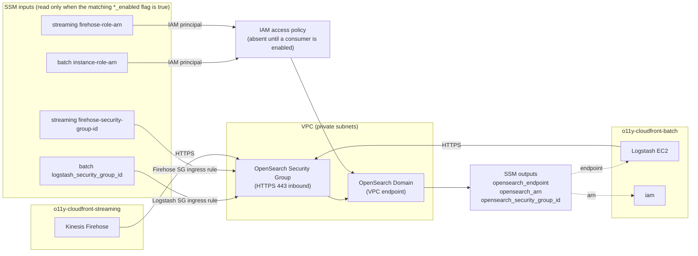
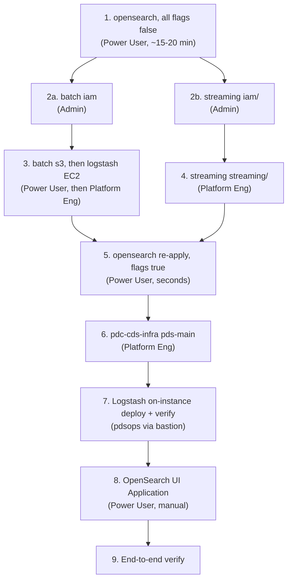

# PDS o11y-platform - Deployment Runbook

This is the single runbook for deploying, updating, and testing the PDS observability stack: the shared OpenSearch domain in this repo plus its two consumers, [o11y-cloudfront-batch](https://github.com/NASA-PDS/o11y-cloudfront-batch) and [o11y-cloudfront-streaming](https://github.com/NASA-PDS/o11y-cloudfront-streaming), and the CloudFront wiring in [pdc-cds-infra](https://github.com/NASA-PDS/pdc-cds-infra).

Each component repo documents its own modules (inputs, apply, verify, update). This runbook owns the **order** of phases, the **permissions** each needs, and the **cross-repo SSM contract**. It links to the component docs instead of repeating them.

| I want to... | Go to |
|---|---|
| Deploy a venue from scratch | [Initial deployment](#initial-deployment) |
| Change an already-deployed component | [Updating](#updating) |
| Check that a deployment works | [Testing](#testing) |
| See which SSM parameters connect the repos | [SSM contract](#ssm-contract) |

## Architecture



- **Network:** the domain is VPC-only. Security group ingress rules (port 443) for Logstash and Firehose live in this module. Each consumer's security group ID is read from SSM at plan time.
- **API:** an IAM resource-based policy allows the consumer role ARNs, read from SSM at plan time.
- **Gating:** both are controlled by `o11y_cloudfront_batch_enabled` and `o11y_cloudfront_streaming_enabled`, so the domain can bootstrap before any consumer exists.
- **Discovery:** consumers read the domain's SSM outputs at plan time. There is no shared Terraform state between repos.
- **Ops access:** the AWS-hosted [OpenSearch UI Application](#phase-8---opensearch-ui-application), not the built-in `/_dashboards` endpoint.

## Prerequisites

Tools: [Terraform](https://developer.hashicorp.com/terraform/downloads) >= 1.10.0, [Terragrunt](https://terragrunt.gruntwork.io/docs/getting-started/install/) >= 0.55, [Task](https://taskfile.dev) (`brew install go-task/tap/go-task`), and the AWS CLI.

Checkouts: `cds-infra-deploy` (all venue inputs live there as `venues/<venue>/<repo>/<module>/terragrunt.hcl`), this repo (for `scripts/smoke-test.sh`), and `o11y-cloudfront-streaming` (for its Kinesis smoke test in Phase 6).

Gather these values before Phase 1. Every phase opens with a **Setup** block that assigns the ones it uses, so you can run any phase in a new shell. Edit the values in each Setup block before you run it.

| Variable | Meaning | Value |
|---|---|---|
| `VENUE` | Venue to deploy | `dev`, `test`, or `prod` |
| `REGION` | AWS region of the venue | `us-west-2` in the examples; use the region in the venue's `cds-infra-deploy` inputs |
| `PROFILE_NAME` | AWS CLI profile for the phase's permission tier | Your profile for that tier; see [Required AWS permissions](#required-aws-permissions) |
| `CDS_INFRA_DEPLOY_DIR` | Local `cds-infra-deploy` checkout | The path to your clone |
| `O11Y_PLATFORM_DIR` | Local `o11y-platform` checkout | The path to your clone |
| `O11Y_STREAMING_DIR` | Local `o11y-cloudfront-streaming` checkout | The path to your clone |

Terraform's S3 backend needs exported credentials with `AWS_PROFILE` unset. Each Setup block does this with `aws configure export-credentials`. Credentials expire after about an hour; re-run the Setup block if a command reports expired credentials.

## Required AWS permissions

A principal needs the highest tier of every module it deploys.

| Tier | Who | Required when |
|---|---|---|
| **Admin** | Ops/Admin SSO role with `iam:CreateRole` | Any IAM *creation* module: the `iam` modules in the consumer repos |
| **Platform Engineer** | SSO role with `iam:PassRole` (not `CreateRole`) | Any module that assigns an existing role ARN to a non-IAM resource: Firehose, Lambda, EC2 instance profile, CloudFront real-time log config |
| **Power User** | Standard `Project-Power-User` SSO | Everything else: OpenSearch bootstrap, S3, Kinesis, CloudWatch, SSM reads |

`iam:PassRole` is not `iam:CreateRole`. A module that only reads a role ARN from SSM and assigns it to a service resource is Platform Engineer, not Admin.

## SSM contract

Parameters that cross a repo boundary. Each repo publishes what the next phase reads, and consumers read them at plan time. Parameters used inside a single component are documented in that component's README.

| Parameter path | Published by (phase) | Read by | Read when |
|---|---|---|---|
| `/pds/o11y-platform/opensearch/opensearch_endpoint` | platform `opensearch` (1) | batch `logstash` | always |
| `/pds/o11y-platform/opensearch/opensearch_arn` | platform `opensearch` (1) | batch `iam` | always |
| `/pds/o11y-platform/opensearch/opensearch_security_group_id` | platform `opensearch` (1), when `vpc_enabled` | `scripts/smoke-test.sh` | - |
| `/pds/o11y-cloudfront-batch/iam/roles/ec2/instance-role-arn` | batch `iam` (2a) | platform `opensearch`; `pds-main` | `o11y_cloudfront_batch_enabled`; `enable_o11y_batch` |
| `/pds/o11y-cloudfront-batch/ec2/logstash_security_group_id` | batch `logstash` (3) | platform `opensearch` | `o11y_cloudfront_batch_enabled` and `vpc_enabled` |
| `/pds/o11y-cloudfront-streaming/firehose/firehose-role-arn` | streaming `iam/` (2b) | platform `opensearch`; `pds-main` | `o11y_cloudfront_streaming_enabled`; `enable_o11y_streaming` |
| `/pds/o11y-cloudfront-streaming/firehose/firehose-security-group-id` | streaming `streaming/` (4) | platform `opensearch` | `o11y_cloudfront_streaming_enabled` and `vpc_enabled` |
| `/pds/o11y-cloudfront-streaming/cloudfront/cloudfront-role-arn` | streaming `iam/` (2b) | `pds-main` | `enable_o11y_streaming` |
| `/pds/o11y-cloudfront-streaming/kinesis/kinesis-stream-arn` | streaming `iam/` (2b); the ARN is computed, the stream is created in phase 4 | `pds-main` | `enable_o11y_streaming` |
| `/pds/pdc-cds-infra/s3/pds-logs-bucket-arn` | `pds-main` (6); seeded by hand before phase 2b on a first deploy | streaming `iam/` and `streaming/` | always |

Streaming looks up the OpenSearch domain by name, not through SSM.

## Deployment flow

> **`opensearch` is always applied twice.** Phase 1 creates the domain with every `*_enabled` flag `false`, because the consumers don't exist yet. Phase 5 sets the flags to `true` after the consumers have published their SSM parameters. Phase 5 is an access-policy and ingress-rule update only; the domain is not redeployed.
>
> Enabling a flag before its parameters exist fails the plan with a missing-parameter error. That error means an earlier phase is incomplete.
>
> | Flag | Phases that must already be applied |
> |---|---|
> | `o11y_cloudfront_batch_enabled` | batch `iam` (2a) and `logstash` (3) |
> | `o11y_cloudfront_streaming_enabled` | streaming `iam/` (2b) and `streaming/` (4) |
>
> Until a flag is on, that consumer has no access-policy entry and no ingress rule, so it cannot reach the domain.



Phase 6 runs last, after every component it points at exists. See [Phase 6](#phase-6---cloudfront-pds-main) for why.

## Initial deployment

Run the phases in order. In each phase, run **Setup**, then **Steps**, then **Verify**. Do not continue until Verify passes. Phases 1, 6, and 7 end with a smoke test; see [Testing](#testing).

### Phase 1 - Bootstrap OpenSearch

**Tier:** Power User. **Time:** 15-20 min. **Creates:** the VPC-only domain; publishes its endpoint, ARN, and security group ID to SSM. **Inputs:** [opensearch README](opensearch/README.md#deploy).

**Setup**

```bash
VENUE="dev"                                       # dev | test | prod
REGION="us-west-2"
PROFILE_NAME="<power-user-sso-profile>"
CDS_INFRA_DEPLOY_DIR="<path-to-cds-infra-deploy-checkout>"
O11Y_PLATFORM_DIR="<path-to-o11y-platform-checkout>"

eval $(aws configure export-credentials --profile "${PROFILE_NAME}" --format env)
unset AWS_PROFILE
export AWS_DEFAULT_REGION="${REGION}"
cd "${CDS_INFRA_DEPLOY_DIR}"
```

**Steps**

1. Confirm both consumer flags are `false` or unset:

   ```bash
   grep -nE 'o11y_cloudfront_(batch|streaming)_enabled' \
     "venues/${VENUE}/o11y-platform/opensearch/terragrunt.hcl"
   ```

2. Plan and apply:

   ```bash
   task plan  VENUE="${VENUE}" COMPONENT=o11y-platform/opensearch
   task apply VENUE="${VENUE}" COMPONENT=o11y-platform/opensearch
   ```

**Verify** (OpenSearch smoke test)

```bash
bash "${O11Y_PLATFORM_DIR}/scripts/smoke-test.sh" "${VENUE}"
```

Expect: `All 7 check(s) passed.`

**If it fails**

- Domain is `Processing`: wait, then re-run.
- SSM parameter missing: the apply did not complete.

### Phase 2 - IAM

**Tier:** Admin. **Needs:** Phase 1. **Creates:** the consumer IAM roles; publishes their ARNs to SSM. 2a and 2b can run in either order. **Inputs:** [batch `iam`](https://github.com/NASA-PDS/o11y-cloudfront-batch/blob/main/terraform/README.md), [streaming `iam/`](https://github.com/NASA-PDS/o11y-cloudfront-streaming/blob/main/terraform/iam/README.md).

**Setup** (2a and 2b)

```bash
VENUE="dev"                                       # dev | test | prod
REGION="us-west-2"
PROFILE_NAME="<admin-sso-profile>"
CDS_INFRA_DEPLOY_DIR="<path-to-cds-infra-deploy-checkout>"

eval $(aws configure export-credentials --profile "${PROFILE_NAME}" --format env)
unset AWS_PROFILE
export AWS_DEFAULT_REGION="${REGION}"
cd "${CDS_INFRA_DEPLOY_DIR}"
```

**2a - o11y-cloudfront-batch**

1. Plan and apply:

   ```bash
   task plan  VENUE="${VENUE}" COMPONENT=o11y-cloudfront-batch/iam
   task apply VENUE="${VENUE}" COMPONENT=o11y-cloudfront-batch/iam
   ```

2. Verify:

   ```bash
   aws ssm get-parameter --region "${REGION}" \
     --name /pds/o11y-cloudfront-batch/iam/roles/ec2/instance-role-arn \
     --query Parameter.Value --output text
   ```

   Expect: an IAM role ARN.

**2b - o11y-cloudfront-streaming**

1. Check the logs bucket ARN parameter:

   ```bash
   aws ssm get-parameter --region "${REGION}" \
     --name /pds/pdc-cds-infra/s3/pds-logs-bucket-arn \
     --query Parameter.Value --output text
   ```

   Expect: `arn:aws:s3:::pds-logs-<venue>`.

2. Only if step 1 returned `ParameterNotFound`, seed it:

   ```bash
   aws ssm put-parameter \
     --region "${REGION}" \
     --name /pds/pdc-cds-infra/s3/pds-logs-bucket-arn \
     --value "arn:aws:s3:::pds-logs-${VENUE}" \
     --type String
   ```

3. Plan and apply:

   ```bash
   task plan  VENUE="${VENUE}" COMPONENT=o11y-cloudfront-streaming/iam
   task apply VENUE="${VENUE}" COMPONENT=o11y-cloudfront-streaming/iam
   ```

4. Verify:

   ```bash
   for P in cloudfront/cloudfront-role-arn firehose/firehose-role-arn kinesis/kinesis-stream-arn; do
     aws ssm get-parameter --region "${REGION}" \
       --name "/pds/o11y-cloudfront-streaming/${P}" \
       --query Parameter.Value --output text
   done
   ```

   Expect: three ARNs.

**Notes**

- Phase 6 takes over the bucket ARN parameter; no import is needed.
- The Kinesis ARN is computed. The stream exists after Phase 4. Do not deploy `streaming/` yet.

### Phase 3 - Batch S3 and Logstash EC2

**Tier:** 3a Power User, 3b Platform Engineer. **Needs:** Phases 1 and 2a. **Creates:** the log bucket (3a) and the Logstash EC2 and its security group (3b). Logstash is installed in Phase 7. **Inputs:** [batch Terraform README](https://github.com/NASA-PDS/o11y-cloudfront-batch/blob/main/terraform/README.md).

**Setup**

```bash
VENUE="dev"                                       # dev | test | prod
REGION="us-west-2"
CDS_INFRA_DEPLOY_DIR="<path-to-cds-infra-deploy-checkout>"
PROFILE_POWER_USER="<power-user-sso-profile>"
PROFILE_PLATFORM_ENGINEER="<platform-engineer-sso-profile>"

export AWS_DEFAULT_REGION="${REGION}"
cd "${CDS_INFRA_DEPLOY_DIR}"
```

**Steps**

1. 3a - `s3` (Power User):

   ```bash
   eval $(aws configure export-credentials --profile "${PROFILE_POWER_USER}" --format env)
   unset AWS_PROFILE

   task plan  VENUE="${VENUE}" COMPONENT=o11y-cloudfront-batch/s3
   task apply VENUE="${VENUE}" COMPONENT=o11y-cloudfront-batch/s3
   ```

2. 3b - `logstash` (Platform Engineer):

   ```bash
   eval $(aws configure export-credentials --profile "${PROFILE_PLATFORM_ENGINEER}" --format env)
   unset AWS_PROFILE

   task plan  VENUE="${VENUE}" COMPONENT=o11y-cloudfront-batch/logstash
   task apply VENUE="${VENUE}" COMPONENT=o11y-cloudfront-batch/logstash
   ```

**Verify**

```bash
aws ssm get-parameter --region "${REGION}" \
  --name /pds/o11y-cloudfront-batch/s3/bucket_name \
  --query Parameter.Value --output text
aws ssm get-parameter --region "${REGION}" \
  --name /pds/o11y-cloudfront-batch/ec2/logstash_security_group_id \
  --query Parameter.Value --output text
```

Expect: a bucket name, then a `sg-` ID.

### Phase 4 - Streaming

**Tier:** Platform Engineer. **Needs:** Phases 1 and 2b. **Creates:** the Kinesis stream, Lambda transform, Firehose delivery stream, and Firehose security group. **Inputs:** [streaming Terraform README](https://github.com/NASA-PDS/o11y-cloudfront-streaming/blob/main/terraform/README.md).

**Setup**

```bash
VENUE="dev"                                       # dev | test | prod
REGION="us-west-2"
PROFILE_NAME="<platform-engineer-sso-profile>"
CDS_INFRA_DEPLOY_DIR="<path-to-cds-infra-deploy-checkout>"

eval $(aws configure export-credentials --profile "${PROFILE_NAME}" --format env)
unset AWS_PROFILE
export AWS_DEFAULT_REGION="${REGION}"
cd "${CDS_INFRA_DEPLOY_DIR}"
```

**Steps**

1. Plan and apply:

   ```bash
   task plan  VENUE="${VENUE}" COMPONENT=o11y-cloudfront-streaming/streaming
   task apply VENUE="${VENUE}" COMPONENT=o11y-cloudfront-streaming/streaming
   ```

**Verify**

```bash
aws ssm get-parameter --region "${REGION}" \
  --name /pds/o11y-cloudfront-streaming/firehose/firehose-security-group-id \
  --query Parameter.Value --output text

aws kinesis describe-stream-summary --region "${REGION}" \
  --stream-name pds-o11y-cloudfront-streaming-kinesis \
  --query StreamDescriptionSummary.StreamStatus --output text
```

Expect: a `sg-` ID, then `ACTIVE`.

**Notes**

- Firehose cannot write to the domain until Phase 5.

### Phase 5 - Grant consumers OpenSearch access

**Tier:** Power User. **Needs:** Phases 2a, 2b, 3, and 4. **Time:** seconds. **Does:** the second `opensearch` apply. Adds both consumer roles to the access policy and both security groups to the ingress rules.

**Setup**

```bash
VENUE="dev"                                       # dev | test | prod
REGION="us-west-2"
PROFILE_NAME="<power-user-sso-profile>"
CDS_INFRA_DEPLOY_DIR="<path-to-cds-infra-deploy-checkout>"

eval $(aws configure export-credentials --profile "${PROFILE_NAME}" --format env)
unset AWS_PROFILE
export AWS_DEFAULT_REGION="${REGION}"
cd "${CDS_INFRA_DEPLOY_DIR}"
```

**Steps**

1. Set both flags to `true` in `venues/<venue>/o11y-platform/opensearch/terragrunt.hcl`:

   ```hcl
   o11y_cloudfront_batch_enabled     = true
   o11y_cloudfront_streaming_enabled = true
   ```

2. Confirm the edit:

   ```bash
   grep -nE 'o11y_cloudfront_(batch|streaming)_enabled' \
     "venues/${VENUE}/o11y-platform/opensearch/terragrunt.hcl"
   ```

   Expect: both lines end in `true`.

3. Plan:

   ```bash
   task plan VENUE="${VENUE}" COMPONENT=o11y-platform/opensearch
   ```

   Expect: only the access policy changes and two ingress rules are added. No `aws_opensearch_domain.this` replacement.

4. Apply:

   ```bash
   task apply VENUE="${VENUE}" COMPONENT=o11y-platform/opensearch
   ```

**Verify**

```bash
DOMAIN_NAME=$(aws ssm get-parameter --region "${REGION}" \
  --name /pds/o11y-platform/opensearch/opensearch_arn \
  --query Parameter.Value --output text | awk -F/ '{print $NF}')
aws opensearch describe-domain --region "${REGION}" --domain-name "${DOMAIN_NAME}" \
  --query 'DomainStatus.AccessPolicies' --output text

OS_SG_ID=$(aws ssm get-parameter --region "${REGION}" \
  --name /pds/o11y-platform/opensearch/opensearch_security_group_id \
  --query Parameter.Value --output text)
aws ec2 describe-security-group-rules --region "${REGION}" \
  --filters "Name=group-id,Values=${OS_SG_ID}" \
  --query 'SecurityGroupRules[?IsEgress==`false`].[ReferencedGroupInfo.GroupId,FromPort]' \
  --output text
```

Expect:

- The access policy lists the batch `instance-role-arn` and the streaming `firehose-role-arn`.
- Two ingress rows on port `443`: the Logstash security group and the Firehose security group.

### Phase 6 - CloudFront (`pds-main`)

**Tier:** Platform Engineer. **Needs:** Phases 2a, 2b, 4, and 5. **Creates:** the CloudFront real-time log config (to Kinesis) and the `AllowO11yBatchLogstashRead` and `AllowFirehoseWrite` statements on the `pds-logs-<venue>` bucket policy. **Inputs:** [pds-main o11y integration](https://github.com/NASA-PDS/pdc-cds-infra/blob/main/terraform/cloudfront/pds-main/README.md#o11y-integration).

**Setup**

```bash
VENUE="dev"                                       # dev | test | prod
REGION="us-west-2"
PROFILE_NAME="<platform-engineer-sso-profile>"
CDS_INFRA_DEPLOY_DIR="<path-to-cds-infra-deploy-checkout>"
O11Y_STREAMING_DIR="<path-to-o11y-cloudfront-streaming-checkout>"

eval $(aws configure export-credentials --profile "${PROFILE_NAME}" --format env)
unset AWS_PROFILE
export AWS_DEFAULT_REGION="${REGION}"
cd "${CDS_INFRA_DEPLOY_DIR}"
```

**Steps**

1. Confirm both flags are `true`:

   ```bash
   grep -nE 'enable_o11y_(batch|streaming)' \
     "venues/${VENUE}/pdc-cds-infra/cloudfront/pds-main/terragrunt.hcl"
   ```

   Expect: `true` or no match (the module default is `true`).

2. Plan and apply:

   ```bash
   task plan  VENUE="${VENUE}" COMPONENT=pdc-cds-infra/cloudfront/pds-main
   task apply VENUE="${VENUE}" COMPONENT=pdc-cds-infra/cloudfront/pds-main
   ```

**Verify**

```bash
aws cloudfront list-realtime-log-configs \
  --query 'RealtimeLogConfigs.Items[].Name' --output text

aws s3api get-bucket-policy --bucket "pds-logs-${VENUE}" \
  --query Policy --output text
```

Expect: `pds-cloudfront-realtime-log-config` is listed. The bucket policy contains `AllowO11yBatchLogstashRead` and `AllowFirehoseWrite`.

**Verify** (streaming smoke test)

Wait for the distribution to finish deploying (several minutes), then follow [Verify](https://github.com/NASA-PDS/o11y-cloudfront-streaming/blob/main/terraform/README.md#verify) in the streaming repo.

**Notes**

- Runs last so the stream exists, OpenSearch accepts both consumers, and a rollback is setting both flags to `false`.
- `enable_o11y_batch` is needed only if `S3_CF_BUCKET_NAME` is set.
- The bucket policy check needs `s3:GetBucketPolicy`.
- The smoke test stops at Kinesis. OpenSearch delivery is checked in [Phase 9](#phase-9---end-to-end-verify).

### Phase 7 - Deploy Logstash and verify

**Tier:** `pdsops` on the EC2, through the bastion. **Needs:** Phases 3 and 5 (and 6 if `S3_CF_BUCKET_NAME` is set). **Does:** installs and starts Logstash on the Phase 3 instance. The steps are in the batch repo and set their own variables.

**Steps**

1. Reach the instance: [Access model](https://github.com/NASA-PDS/o11y-cloudfront-batch/blob/main/terraform/logstash/README.md#access-model).
2. Deploy Logstash: [First-boot setup](https://github.com/NASA-PDS/o11y-cloudfront-batch/blob/main/terraform/logstash/README.md#first-boot-setup).

**Verify** (Logstash smoke test)

Follow [Smoke test](https://github.com/NASA-PDS/o11y-cloudfront-batch/blob/main/terraform/logstash/README.md#3-smoke-test) in the batch repo.

Expect: exit code 0 and `PASS` on every check.

**If it fails**

- OpenSearch timeout or 403: the Phase 5 access policy or ingress rule is not in effect.
- Bucket check: the Phase 3 bucket or the Phase 2a IAM policy.
- Other: [Operations Runbook](https://github.com/NASA-PDS/o11y-cloudfront-batch/blob/main/docs/operations.md#troubleshooting).

**Notes**

- This smoke test does not read the CloudFront logs bucket. Phase 9 covers that input.
- Other checks (bootstrap, data flow): [Verify the deployment](https://github.com/NASA-PDS/o11y-cloudfront-batch/blob/main/terraform/logstash/README.md#verify-the-deployment).

### Phase 8 - OpenSearch UI Application

**Tier:** Power User. **Needs:** Phase 1. **Creates:** the AWS-hosted OpenSearch UI Application with IAM auth. All steps are manual (CLI and console).

**Setup**

```bash
REGION="us-west-2"
PROFILE_NAME="<power-user-sso-profile>"

eval $(aws configure export-credentials --profile "${PROFILE_NAME}" --format env)
unset AWS_PROFILE
export AWS_DEFAULT_REGION="${REGION}"

DOMAIN_NAME=$(aws ssm get-parameter --region "${REGION}" \
  --name /pds/o11y-platform/opensearch/opensearch_arn \
  --query Parameter.Value --output text | awk -F/ '{print $NF}')
echo "${DOMAIN_NAME}"
```

Expect: the domain name.

**Steps**

1. Authorize VPC access (once per domain):

   ```bash
   aws opensearch authorize-vpc-endpoint-access --region "${REGION}" \
     --domain-name "${DOMAIN_NAME}" \
     --service application.opensearchservice.amazonaws.com

   aws opensearch list-vpc-endpoint-access --region "${REGION}" \
     --domain-name "${DOMAIN_NAME}"
   ```

   Expect: the list includes `application.opensearchservice.amazonaws.com`.

2. Create the application. In the console, open **Amazon OpenSearch Service > OpenSearch UI (Dashboards) > Create application**, then:
   - **Application name:** `pds-<venue>-o11y-ui`.
   - **Authentication with IAM Identity Center:** leave unchecked.
   - **OpenSearch application admins:** choose **Grant administrator's permission to specific user(s)**, select **IAM users**, and add the ops IAM role ARN(s).
   - Choose **Create**.

3. Associate the domain. On the application page, choose **Manage data sources**, select the domain from Setup, then **Next > Save**.

**Verify**

Launch the application, open **Dev Tools**, and run:

```text
GET _cluster/health
```

Expect: `"status"` is `green` or `yellow`.

**If it fails**

- 403 in Dev Tools: your role is not in `ops_role_arns` in the venue's `opensearch/terragrunt.hcl`.

**Notes**

- No Terraform resource exists yet for the UI Application ([hashicorp/terraform-provider-aws#45082](https://github.com/hashicorp/terraform-provider-aws/issues/45082)) or the VPC authorization ([#41879](https://github.com/hashicorp/terraform-provider-aws/issues/41879)).

### Phase 9 - End-to-end verify

**Tier:** the ops role from Phase 8. **Needs:** Phases 6, 7, and 8. Uses the OpenSearch UI only, so there is no Setup.

**Steps**

1. Request a few URLs under `/data` through the CloudFront distribution.
2. In OpenSearch UI **Dev Tools**, run:

   ```text
   GET _cat/indices?v
   ```

**Verify**

| Pipeline | Expect |
|---|---|
| Streaming | Index `pds-o11y-cloudfront-streaming-index*` (one per day) appears within minutes. `docs.count` grows on re-run. |
| Batch | Index `<INDEX_PREFIX>-YYYY-MM` (one per month) appears after Logstash processes the next delivered log files. `docs.count` is greater than 0. |

**If an index is missing**

| Missing | Check |
|---|---|
| Streaming | Log config attached and distribution deployed (Phase 6); Firehose delivery errors. See [streaming troubleshooting](https://github.com/NASA-PDS/o11y-cloudfront-streaming/blob/main/terraform/README.md#troubleshooting). |
| Batch | Logstash service, pipeline stats, bad-log file. See [Monitoring](https://github.com/NASA-PDS/o11y-cloudfront-batch/blob/main/docs/operations.md#monitoring). |

## Updating

Re-run only the affected phase. Each component README owns the procedure for its own change; this table only says where to look.

| Change | Procedure | Notes |
|---|---|---|
| OpenSearch engine version, node count, instance type | [opensearch README: Upgrade](opensearch/README.md#upgrade) | Engine upgrade is a blue/green update, about 30 minutes in `Processing` |
| Consumer role or security group recreated | Re-run [Phase 5](#phase-5---grant-consumers-opensearch-access) | The SSM value changes, so the access policy and ingress rule must follow |
| Operator roles with domain access | Edit `ops_role_arns` in the venue's `opensearch/terragrunt.hcl`, then re-run [Phase 5](#phase-5---grant-consumers-opensearch-access) | Access-policy update only |
| Batch IAM, S3, or Logstash instance | [batch Terraform README](https://github.com/NASA-PDS/o11y-cloudfront-batch/blob/main/terraform/README.md) (each module has an Update note) | A `logstash_version` change replaces the instance |
| Logstash pipeline config or `regexes.yaml` | batch [Update pipeline configuration](https://github.com/NASA-PDS/o11y-cloudfront-batch/blob/main/docs/operations.md#update-pipeline-configuration) | No Terraform change. Test first with the [pipeline tests](https://github.com/NASA-PDS/o11y-cloudfront-batch/blob/main/tests/README.md#running-the-integration-tests-with-docker) |
| Streaming Lambda, Kinesis, Firehose, or IAM | [streaming Terraform README: Updating](https://github.com/NASA-PDS/o11y-cloudfront-streaming/blob/main/terraform/README.md#updating) | |
| CloudFront log wiring or bucket access | pdc-cds-infra [`pds-main` README](https://github.com/NASA-PDS/pdc-cds-infra/blob/main/terraform/cloudfront/pds-main/README.md#o11y-integration) | |
| EC2, S3, or IAM module version | [pdc-tf-modules](https://github.com/NASA-PDS/pdc-tf-modules) | Update the module reference in the consuming component, then re-run its phase |

## Testing

### Smoke tests

Run each smoke test in its phase of the initial deployment, and again after any change to the part of the stack it covers. This runbook says when to run each; the procedure and expected result are documented in the repo that owns the script.

| Smoke test | Run it | Procedure |
|---|---|---|
| OpenSearch domain | [Phase 1](#phase-1---bootstrap-opensearch), after the apply. Again after any `opensearch` apply that changes the domain. | [Phase 1 Verify](#phase-1---bootstrap-opensearch) (this repo) |
| Streaming | [Phase 6](#phase-6---cloudfront-pds-main), after the distribution finishes deploying. Again after changing the log config, the Kinesis stream, or Firehose. | [o11y-cloudfront-streaming: Verify](https://github.com/NASA-PDS/o11y-cloudfront-streaming/blob/main/terraform/README.md#verify) |
| Logstash | [Phase 7](#phase-7---deploy-logstash-and-verify), after the Logstash deploy and Phase 5. Again after each Logstash deploy. | [o11y-cloudfront-batch: Smoke test](https://github.com/NASA-PDS/o11y-cloudfront-batch/blob/main/terraform/logstash/README.md#3-smoke-test) |

### Other checks

| What | Test | When |
|---|---|---|
| Cross-repo wiring | Verify steps in Phases 5 and 6 | After changing a flag, role, or security group |
| Logstash pipeline logic | batch [`tests/README.md`](https://github.com/NASA-PDS/o11y-cloudfront-batch/blob/main/tests/README.md#running-the-integration-tests-with-docker) | Before deploying any pipeline change |
| Data flow, both pipelines | [Phase 9](#phase-9---end-to-end-verify) | After an initial deployment or any change to the path |

## Teardown

Irreversible: this deletes all indexed data. Destroy in reverse phase order, using the tier that created each resource.

**Setup**

```bash
VENUE="dev"                                       # dev | test | prod
REGION="us-west-2"
CDS_INFRA_DEPLOY_DIR="<path-to-cds-infra-deploy-checkout>"
PROFILE_ADMIN="<admin-sso-profile>"
PROFILE_PLATFORM_ENGINEER="<platform-engineer-sso-profile>"
PROFILE_POWER_USER="<power-user-sso-profile>"

export AWS_DEFAULT_REGION="${REGION}"
cd "${CDS_INFRA_DEPLOY_DIR}"
```

**Steps**

1. Turn off the CloudFront integration (Platform Engineer). Set `enable_o11y_batch` and `enable_o11y_streaming` to `false` in `venues/<venue>/pdc-cds-infra/cloudfront/pds-main/terragrunt.hcl`, then:

   ```bash
   eval $(aws configure export-credentials --profile "${PROFILE_PLATFORM_ENGINEER}" --format env)
   unset AWS_PROFILE

   task plan  VENUE="${VENUE}" COMPONENT=pdc-cds-infra/cloudfront/pds-main
   task apply VENUE="${VENUE}" COMPONENT=pdc-cds-infra/cloudfront/pds-main
   ```

2. Destroy streaming and Logstash (Platform Engineer):

   ```bash
   task destroy VENUE="${VENUE}" COMPONENT=o11y-cloudfront-streaming/streaming
   task destroy VENUE="${VENUE}" COMPONENT=o11y-cloudfront-batch/logstash
   ```

3. Destroy the batch bucket (Power User):

   ```bash
   eval $(aws configure export-credentials --profile "${PROFILE_POWER_USER}" --format env)
   unset AWS_PROFILE

   task destroy VENUE="${VENUE}" COMPONENT=o11y-cloudfront-batch/s3
   ```

4. Destroy the IAM roles (Admin):

   ```bash
   eval $(aws configure export-credentials --profile "${PROFILE_ADMIN}" --format env)
   unset AWS_PROFILE

   task destroy VENUE="${VENUE}" COMPONENT=o11y-cloudfront-streaming/iam
   task destroy VENUE="${VENUE}" COMPONENT=o11y-cloudfront-batch/iam
   ```

5. Destroy the domain (Power User):

   ```bash
   eval $(aws configure export-credentials --profile "${PROFILE_POWER_USER}" --format env)
   unset AWS_PROFILE

   task destroy VENUE="${VENUE}" COMPONENT=o11y-platform/opensearch
   ```

**Notes**

- Roles must outlive the resources that use them, so IAM is destroyed after the resources.
- Per-component notes are in each repo's README.

## Architecture notes

- **State:** S3 backend, key `o11y-platform/opensearch.tfstate`. Bucket, region, and lock come from Terragrunt in `cds-infra-deploy`.
- **Venue inputs** (VPC, subnets, flags) are Terragrunt inputs in `cds-infra-deploy`. The `opensearch/tfvars/*.tfvars.example` files are a reference for plain Terraform, not the operational path.
- **Adding a consumer:** the consumer publishes its role ARN (and security group ID, if it needs VPC access) to SSM. This module gets a `<consumer>_enabled` variable (default `false`), a `data "aws_ssm_parameter"` block gated on it, an entry in `local.opensearch_access_principals`, and a gated `aws_vpc_security_group_ingress_rule`. Add the new parameters to the [SSM contract](#ssm-contract) and a phase to this runbook.
