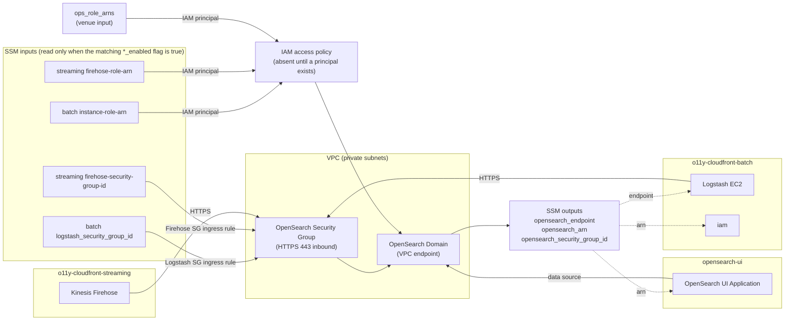
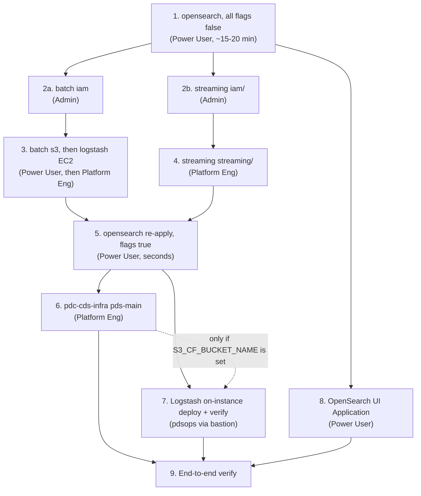

# PDS o11y-platform - Deployment Runbook

Runbook for deploying, updating, testing, and tearing down the PDS observability stack: the OpenSearch domain and UI application in this repo, the consumers [o11y-cloudfront-batch](https://github.com/NASA-PDS/o11y-cloudfront-batch) and [o11y-cloudfront-streaming](https://github.com/NASA-PDS/o11y-cloudfront-streaming), and the CloudFront wiring in [pdc-cds-infra](https://github.com/NASA-PDS/pdc-cds-infra).

This runbook owns the **order** of phases, the **permissions** each needs, and the **cross-repo SSM contract**. Each component repo documents its own modules and is linked from the phase that deploys it.

| I want to... | Go to |
|---|---|
| Deploy a venue from scratch | [Initial deployment](#initial-deployment) |
| Change an already-deployed component | [Updating](#updating) |
| Check that a deployment works | [Testing](#testing) |
| See which SSM parameters connect the repos | [SSM contract](#ssm-contract) |

## Architecture



- **Network:** VPC-only. The port 443 ingress rules from the Logstash and Firehose security groups live in this module; each security group ID is read from SSM at plan time.
- **API:** an IAM resource-based policy allows the consumer role ARNs (read from SSM at plan time) and `ops_role_arns`.
- **Gating:** `o11y_cloudfront_batch_enabled` and `o11y_cloudfront_streaming_enabled` gate each consumer's SSM reads, ingress rule, and policy entry, so the domain can bootstrap before any consumer exists.
- **Discovery:** consumers read the domain's SSM outputs at plan time, with no shared Terraform state between repos.
- **Ops access:** the AWS-hosted [OpenSearch UI Application](#phase-8---opensearch-ui-application), not the built-in `/_dashboards` endpoint.

## Prerequisites

Tools: [Terraform](https://developer.hashicorp.com/terraform/downloads) >= 1.10.0, [Terragrunt](https://terragrunt.gruntwork.io/docs/getting-started/install/) >= 0.55, [Task](https://taskfile.dev) (`brew install go-task/tap/go-task`), [jq](https://jqlang.org) (used by `scripts/smoke-test.sh`), and the AWS CLI.

Checkouts: `cds-infra-deploy` (all venue inputs live there as `venues/<venue>/<repo>/<module>/terragrunt.hcl`), this repo (for `scripts/smoke-test.sh`), and `o11y-cloudfront-streaming` (for its Kinesis smoke test in Phase 6).

Each phase opens with a **Setup** block that assigns the variables it uses, so you can run any phase in a new shell. Edit the values before you run it.

| Variable | Meaning | Value |
|---|---|---|
| `VENUE` | Venue to deploy | `dev`, `test`, or `prod` |
| `REGION` | AWS region of the venue | `us-west-2` in the examples; use the region in the venue's `cds-infra-deploy` inputs |
| `PROFILE_NAME` | AWS CLI profile for the phase's permission tier | Your profile for that tier; see [Required AWS permissions](#required-aws-permissions) |
| `CDS_INFRA_DEPLOY_DIR` | Local `cds-infra-deploy` checkout | The path to your clone |
| `O11Y_PLATFORM_DIR` | Local `o11y-platform` checkout | The path to your clone |

Terraform's S3 backend needs exported credentials with `AWS_PROFILE` unset; each Setup block does this. Credentials expire after about an hour; re-run Setup when a command reports them expired.

## Required AWS permissions

A principal needs the highest tier of every module it deploys.

| Tier | Who | Required when |
|---|---|---|
| **Admin** | Ops/Admin SSO role with `iam:CreateRole` | Any IAM *creation* module: the `iam` modules in the consumer repos |
| **Platform Engineer** | SSO role with `iam:PassRole` (not `CreateRole`) | Any module that assigns an existing role ARN to a non-IAM resource: Firehose, Lambda, EC2 instance profile, CloudFront real-time log config |
| **Power User** | Standard `Project-Power-User` SSO | Everything else: OpenSearch bootstrap, S3, Kinesis, CloudWatch, SSM reads |

`iam:PassRole` is not `iam:CreateRole`. A module that only reads a role ARN from SSM and assigns it to a service resource is Platform Engineer, not Admin.

## SSM contract

Parameters that cross a repo boundary, read at plan time. Parameters used inside one component are documented in that component's README.

| Parameter path | Published by (phase) | Read by | Read when |
|---|---|---|---|
| `/pds/o11y-platform/opensearch/opensearch_endpoint` | platform `opensearch` (1) | batch `logstash` | always |
| `/pds/o11y-platform/opensearch/opensearch_arn` | platform `opensearch` (1) | batch `iam`; platform `opensearch-ui` | always |
| `/pds/o11y-platform/opensearch/opensearch_security_group_id` | platform `opensearch` (1), when `vpc_enabled` | `scripts/smoke-test.sh` | - |
| `/pds/o11y-cloudfront-batch/iam/roles/ec2/instance-role-arn` | batch `iam` (2a) | platform `opensearch`; `pds-main` | `o11y_cloudfront_batch_enabled`; `enable_o11y_batch` |
| `/pds/o11y-cloudfront-batch/ec2/logstash_security_group_id` | batch `logstash` (3) | platform `opensearch` | `o11y_cloudfront_batch_enabled` and `vpc_enabled` |
| `/pds/o11y-cloudfront-streaming/firehose/firehose-role-arn` | streaming `iam/` (2b) | platform `opensearch`; `pds-main` | `o11y_cloudfront_streaming_enabled`; `enable_o11y_streaming` |
| `/pds/o11y-cloudfront-streaming/firehose/firehose-security-group-id` | streaming `streaming/` (4) | platform `opensearch` | `o11y_cloudfront_streaming_enabled` and `vpc_enabled` |
| `/pds/o11y-cloudfront-streaming/cloudfront/cloudfront-role-arn` | streaming `iam/` (2b) | `pds-main` | `enable_o11y_streaming` |
| `/pds/o11y-cloudfront-streaming/kinesis/kinesis-stream-arn` | streaming `iam/` (2b); the ARN is computed, the stream is created in phase 4 | `pds-main` | `enable_o11y_streaming` |
| `/pds/pdc-cds-infra/s3/pds-logs-bucket-arn` | `pds-main` (6); seeded by hand before phase 2b on a first deploy | streaming `iam/` and `streaming/` | always |

Streaming looks up the OpenSearch domain by name, not through SSM.

## Deployment flow

> **`opensearch` is always applied twice.** Phase 1 creates the domain with every `*_enabled` flag `false`, because the consumers don't exist yet. Phase 5 sets the flags to `true` after the consumers have published their SSM parameters. Phase 5 is an access-policy and ingress-rule update only; the domain is not redeployed.
>
> Enabling a flag before its parameters exist fails the plan with a missing-parameter error. That error means an earlier phase is incomplete.
>
> | Flag | Phases that must already be applied |
> |---|---|
> | `o11y_cloudfront_batch_enabled` | batch `iam` (2a) and `logstash` (3) |
> | `o11y_cloudfront_streaming_enabled` | streaming `iam/` (2b) and `streaming/` (4) |
>
> Until a flag is on, that consumer has no access-policy entry and no ingress rule, so it cannot reach the domain.



Phase 8 needs only Phase 1; the order above is the order to run them. Phase 6 runs after the stream exists and OpenSearch accepts both consumers; see its Notes.

## Initial deployment

Run the phases in order. In each phase, run **Setup**, then **Steps**, then **Verify**. Do not continue until Verify passes.

**Total time:** about 1.5 hours. Each phase's **Time** is approximate; the Phase 1 domain creation is the longest single wait. Phases 1, 6, and 7 end with a smoke test; see [Testing](#testing).

### Phase 1 - Bootstrap OpenSearch

* **Tier:** Power User.
* **Needs:** none.
* **Time:** 15-20 min.
* **Creates:** the VPC-only domain; publishes its endpoint, ARN, and security group ID to SSM.
* **Inputs:** [opensearch README](opensearch/README.md#deploy).

**Setup**

```bash
VENUE="dev"                                       # dev | test | prod
REGION="us-west-2"
PROFILE_NAME="<power-user-sso-profile>"
CDS_INFRA_DEPLOY_DIR="<path-to-cds-infra-deploy-checkout>"
O11Y_PLATFORM_DIR="<path-to-o11y-platform-checkout>"

eval $(aws configure export-credentials --profile "${PROFILE_NAME}" --format env)
unset AWS_PROFILE
export AWS_DEFAULT_REGION="${REGION}"
cd "${CDS_INFRA_DEPLOY_DIR}"
```

**Steps**

1. Confirm both consumer flags are `false` or unset:

   ```bash
   grep -nE 'o11y_cloudfront_(batch|streaming)_enabled' \
     "venues/${VENUE}/o11y-platform/opensearch/terragrunt.hcl"
   ```

2. Plan and apply:

   ```bash
   task plan  VENUE="${VENUE}" COMPONENT=o11y-platform/opensearch
   task apply VENUE="${VENUE}" COMPONENT=o11y-platform/opensearch
   ```

**Verify** (OpenSearch smoke test)

```bash
bash "${O11Y_PLATFORM_DIR}/scripts/smoke-test.sh" "${VENUE}"
```

Expect: `All 7 check(s) passed.`

**If it fails**

- Domain is `Processing`: wait, then re-run.
- SSM parameter missing: the apply did not complete.

### Phase 2 - IAM

* **Tier:** Admin.
* **Needs:** Phase 1.
* **Order:** 2a and 2b can run in either order.
* **Time:** about 5 min.
* **Creates:** the consumer IAM roles; publishes their ARNs to SSM.
* **Inputs:** [batch `iam`](https://github.com/NASA-PDS/o11y-cloudfront-batch/blob/main/terraform/README.md), [streaming `iam/`](https://github.com/NASA-PDS/o11y-cloudfront-streaming/blob/main/terraform/iam/README.md).

**Setup** (2a and 2b)

```bash
VENUE="dev"                                       # dev | test | prod
REGION="us-west-2"
PROFILE_NAME="<admin-sso-profile>"
CDS_INFRA_DEPLOY_DIR="<path-to-cds-infra-deploy-checkout>"

eval $(aws configure export-credentials --profile "${PROFILE_NAME}" --format env)
unset AWS_PROFILE
export AWS_DEFAULT_REGION="${REGION}"
cd "${CDS_INFRA_DEPLOY_DIR}"
```

**2a - o11y-cloudfront-batch**

1. Plan and apply:

   ```bash
   task plan  VENUE="${VENUE}" COMPONENT=o11y-cloudfront-batch/iam
   task apply VENUE="${VENUE}" COMPONENT=o11y-cloudfront-batch/iam
   ```

2. Verify:

   ```bash
   aws ssm get-parameter --region "${REGION}" \
     --name /pds/o11y-cloudfront-batch/iam/roles/ec2/instance-role-arn \
     --query Parameter.Value --output text
   ```

   Expect: an IAM role ARN.

**2b - o11y-cloudfront-streaming**

1. Check the logs bucket ARN parameter:

   ```bash
   aws ssm get-parameter --region "${REGION}" \
     --name /pds/pdc-cds-infra/s3/pds-logs-bucket-arn \
     --query Parameter.Value --output text
   ```

   Expect: `arn:aws:s3:::pds-logs-<venue>`.

2. Only if step 1 returned `ParameterNotFound`, seed it:

   ```bash
   aws ssm put-parameter \
     --region "${REGION}" \
     --name /pds/pdc-cds-infra/s3/pds-logs-bucket-arn \
     --value "arn:aws:s3:::pds-logs-${VENUE}" \
     --type String
   ```

3. Plan and apply:

   ```bash
   task plan  VENUE="${VENUE}" COMPONENT=o11y-cloudfront-streaming/iam
   task apply VENUE="${VENUE}" COMPONENT=o11y-cloudfront-streaming/iam
   ```

4. Verify:

   ```bash
   for P in cloudfront/cloudfront-role-arn firehose/firehose-role-arn kinesis/kinesis-stream-arn; do
     aws ssm get-parameter --region "${REGION}" \
       --name "/pds/o11y-cloudfront-streaming/${P}" \
       --query Parameter.Value --output text
   done
   ```

   Expect: three ARNs.

**Notes**

- Phase 6 takes over the bucket ARN parameter (`overwrite = true`); no import is needed.
- The Kinesis ARN is computed; the stream is created in Phase 4.

### Phase 3 - Batch S3 and Logstash EC2

* **Tier:** 3a Power User, 3b Platform Engineer.
* **Needs:** Phases 1 and 2a.
* **Time:** about 10 min. The instance then bootstraps Logstash in the background for 5-10 min.
* **Creates:** the log bucket (3a) and the Logstash EC2 and its security group (3b). Userdata installs Logstash at first boot; Phase 7 deploys the pipeline config and starts it.
* **Inputs:** [batch Terraform README](https://github.com/NASA-PDS/o11y-cloudfront-batch/blob/main/terraform/README.md).

**Setup**

```bash
VENUE="dev"                                       # dev | test | prod
REGION="us-west-2"
CDS_INFRA_DEPLOY_DIR="<path-to-cds-infra-deploy-checkout>"
PROFILE_POWER_USER="<power-user-sso-profile>"
PROFILE_PLATFORM_ENGINEER="<platform-engineer-sso-profile>"

export AWS_DEFAULT_REGION="${REGION}"
cd "${CDS_INFRA_DEPLOY_DIR}"
```

**Steps**

1. 3a - `s3` (Power User):

   ```bash
   eval $(aws configure export-credentials --profile "${PROFILE_POWER_USER}" --format env)
   unset AWS_PROFILE

   task plan  VENUE="${VENUE}" COMPONENT=o11y-cloudfront-batch/s3
   task apply VENUE="${VENUE}" COMPONENT=o11y-cloudfront-batch/s3
   ```

2. 3b - `logstash` (Platform Engineer):

   ```bash
   eval $(aws configure export-credentials --profile "${PROFILE_PLATFORM_ENGINEER}" --format env)
   unset AWS_PROFILE

   task plan  VENUE="${VENUE}" COMPONENT=o11y-cloudfront-batch/logstash
   task apply VENUE="${VENUE}" COMPONENT=o11y-cloudfront-batch/logstash
   ```

**Verify**

```bash
aws ssm get-parameter --region "${REGION}" \
  --name /pds/o11y-cloudfront-batch/s3/bucket_name \
  --query Parameter.Value --output text
aws ssm get-parameter --region "${REGION}" \
  --name /pds/o11y-cloudfront-batch/ec2/logstash_security_group_id \
  --query Parameter.Value --output text
```

Expect: a bucket name, then a `sg-` ID.

### Phase 4 - Streaming

* **Tier:** Platform Engineer.
* **Needs:** Phases 1 and 2b.
* **Time:** about 5 min.
* **Creates:** the Kinesis stream, Lambda transform, Firehose delivery stream, and Firehose security group.
* **Inputs:** [streaming Terraform README](https://github.com/NASA-PDS/o11y-cloudfront-streaming/blob/main/terraform/README.md).

**Setup**

```bash
VENUE="dev"                                       # dev | test | prod
REGION="us-west-2"
PROFILE_NAME="<platform-engineer-sso-profile>"
CDS_INFRA_DEPLOY_DIR="<path-to-cds-infra-deploy-checkout>"

eval $(aws configure export-credentials --profile "${PROFILE_NAME}" --format env)
unset AWS_PROFILE
export AWS_DEFAULT_REGION="${REGION}"
cd "${CDS_INFRA_DEPLOY_DIR}"
```

**Steps**

1. Plan and apply:

   ```bash
   task plan  VENUE="${VENUE}" COMPONENT=o11y-cloudfront-streaming/streaming
   task apply VENUE="${VENUE}" COMPONENT=o11y-cloudfront-streaming/streaming
   ```

**Verify**

```bash
aws ssm get-parameter --region "${REGION}" \
  --name /pds/o11y-cloudfront-streaming/firehose/firehose-security-group-id \
  --query Parameter.Value --output text

aws kinesis describe-stream-summary --region "${REGION}" \
  --stream-name pds-o11y-cloudfront-streaming-kinesis \
  --query StreamDescriptionSummary.StreamStatus --output text
```

Expect: a `sg-` ID, then `ACTIVE`.

**Notes**

- Firehose cannot write to the domain until Phase 5.

### Phase 5 - Grant Consumers OpenSearch access

* **Tier:** Power User.
* **Needs:** Phases 2a, 2b, 3, and 4.
* **Time:** seconds.
* **Updates:** the access policy (both consumer roles) and the ingress rules (both security groups). This is the second `opensearch` apply.

**Setup**

```bash
VENUE="dev"                                       # dev | test | prod
REGION="us-west-2"
PROFILE_NAME="<power-user-sso-profile>"
CDS_INFRA_DEPLOY_DIR="<path-to-cds-infra-deploy-checkout>"

eval $(aws configure export-credentials --profile "${PROFILE_NAME}" --format env)
unset AWS_PROFILE
export AWS_DEFAULT_REGION="${REGION}"
cd "${CDS_INFRA_DEPLOY_DIR}"
```

**Steps**

1. Set both flags to `true` in `venues/<venue>/o11y-platform/opensearch/terragrunt.hcl`:

   ```hcl
   o11y_cloudfront_batch_enabled     = true
   o11y_cloudfront_streaming_enabled = true
   ```

2. Confirm the edit:

   ```bash
   grep -nE 'o11y_cloudfront_(batch|streaming)_enabled' \
     "venues/${VENUE}/o11y-platform/opensearch/terragrunt.hcl"
   ```

   Expect: both lines end in `true`.

3. Plan:

   ```bash
   task plan VENUE="${VENUE}" COMPONENT=o11y-platform/opensearch
   ```

   Expect: only the access policy changes and two ingress rules are added. No `aws_opensearch_domain.this` replacement.

4. Apply:

   ```bash
   task apply VENUE="${VENUE}" COMPONENT=o11y-platform/opensearch
   ```

**Verify**

```bash
DOMAIN_NAME=$(aws ssm get-parameter --region "${REGION}" \
  --name /pds/o11y-platform/opensearch/opensearch_arn \
  --query Parameter.Value --output text | awk -F/ '{print $NF}')
aws opensearch describe-domain --region "${REGION}" --domain-name "${DOMAIN_NAME}" \
  --query 'DomainStatus.AccessPolicies' --output text

OS_SG_ID=$(aws ssm get-parameter --region "${REGION}" \
  --name /pds/o11y-platform/opensearch/opensearch_security_group_id \
  --query Parameter.Value --output text)
aws ec2 describe-security-group-rules --region "${REGION}" \
  --filters "Name=group-id,Values=${OS_SG_ID}" \
  --query 'SecurityGroupRules[?IsEgress==`false`].[ReferencedGroupInfo.GroupId,FromPort]' \
  --output text
```

Expect:

- The access policy lists the batch `instance-role-arn` and the streaming `firehose-role-arn`.
- Two ingress rows on port `443`: the Logstash security group and the Firehose security group.

### Phase 6 - CloudFront (`pds-main`)

* **Tier:** Platform Engineer.
* **Needs:** Phases 2a, 2b, 4, and 5.
* **Time:** about 15 min, mostly waiting for the distribution to deploy.
* **Creates:** the CloudFront real-time log config (to Kinesis) and the `AllowO11yBatchLogstashRead` and `AllowFirehoseWrite` statements on the `pds-logs-<venue>` bucket policy.
* **Inputs:** [pds-main o11y integration](https://github.com/NASA-PDS/pdc-cds-infra/blob/main/terraform/cloudfront/pds-main/README.md#o11y-integration).

**Setup**

```bash
VENUE="dev"                                       # dev | test | prod
REGION="us-west-2"
PROFILE_NAME="<platform-engineer-sso-profile>"
CDS_INFRA_DEPLOY_DIR="<path-to-cds-infra-deploy-checkout>"

eval $(aws configure export-credentials --profile "${PROFILE_NAME}" --format env)
unset AWS_PROFILE
export AWS_DEFAULT_REGION="${REGION}"
cd "${CDS_INFRA_DEPLOY_DIR}"
```

**Steps**

1. Confirm both flags are `true`:

   ```bash
   grep -nE 'enable_o11y_(batch|streaming)' \
     "venues/${VENUE}/pdc-cds-infra/cloudfront/pds-main/terragrunt.hcl"
   ```

   Expect: `true` or no match (the module default is `true`).

2. Plan and apply:

   ```bash
   task plan  VENUE="${VENUE}" COMPONENT=pdc-cds-infra/cloudfront/pds-main
   task apply VENUE="${VENUE}" COMPONENT=pdc-cds-infra/cloudfront/pds-main
   ```

**Verify**

1. Check the log config and bucket policy:

   ```bash
   aws cloudfront list-realtime-log-configs \
     --query 'RealtimeLogConfigs.Items[].Name' --output text

   aws s3api get-bucket-policy --bucket "pds-logs-${VENUE}" \
     --query Policy --output text
   ```

   Expect: `pds-cloudfront-realtime-log-config` is listed. The bucket policy contains `AllowO11yBatchLogstashRead` and `AllowFirehoseWrite`.

2. Wait until the distribution is `Deployed`:

   ```bash
   DIST_ID=$(aws cloudfront list-distributions-by-realtime-log-config \
     --realtime-log-config-name pds-cloudfront-realtime-log-config \
     --query 'DistributionList.Items[0].Id' --output text)
   aws cloudfront get-distribution --id "${DIST_ID}" \
     --query Distribution.Status --output text
   ```

   Expect: `Deployed`. On `InProgress`, wait and re-run.

3. Run the streaming smoke test, `scripts/smoke-test-realtime-stream.sh` in o11y-cloudfront-streaming: follow [Verify](https://github.com/NASA-PDS/o11y-cloudfront-streaming/blob/main/terraform/README.md#verify).

   Expect: `PASS`.

**Notes**

- Runs after Phases 4 and 5 so the stream exists and OpenSearch accepts both consumers before CloudFront starts sending logs.
- To roll back, follow [Disabling o11y](https://github.com/NASA-PDS/pdc-cds-infra/blob/main/terraform/cloudfront/pds-main/README.md#disabling-o11y). Setting the flag to `false` and applying once can fail with `RealtimeLogConfigInUse`.
- `enable_o11y_batch` is needed only if `S3_CF_BUCKET_NAME` is set.
- The bucket policy check needs `s3:GetBucketPolicy`.
- The streaming smoke test stops at Kinesis. OpenSearch delivery is checked in [Phase 9](#phase-9---end-to-end-verify).

### Phase 7 - Deploy Logstash and verify

* **Tier:** `pdsops` on the EC2, through the bastion.
* **Needs:** Phases 3 and 5 (and 6 if `S3_CF_BUCKET_NAME` is set).
* **Time:** about 10 min, after the Phase 3 bootstrap finishes.
* **Does:** deploys the pipeline config and starts Logstash on the Phase 3 instance (Logstash was installed by userdata at first boot).
* **Inputs:** none here. The batch steps below set their own variables.

**Steps**

1. Reach the instance: [Access model](https://github.com/NASA-PDS/o11y-cloudfront-batch/blob/main/terraform/logstash/README.md#access-model).
2. Deploy Logstash: [First-boot setup](https://github.com/NASA-PDS/o11y-cloudfront-batch/blob/main/terraform/logstash/README.md#first-boot-setup).

**Verify**

1. Run the Logstash smoke test, `scripts/smoke-test.sh` on the EC2, after the deploy: follow [Smoke test](https://github.com/NASA-PDS/o11y-cloudfront-batch/blob/main/terraform/logstash/README.md#3-smoke-test).

   Expect: exit code 0 and `PASS` on every check.

**If it fails**

- OpenSearch timeout or 403: the Phase 5 access policy or ingress rule is not in effect.
- Bucket check: the Phase 3 bucket or the Phase 2a IAM policy.
- Other: [Operations Runbook](https://github.com/NASA-PDS/o11y-cloudfront-batch/blob/main/docs/operations.md#troubleshooting).

**Notes**

- This smoke test does not read the CloudFront logs bucket. Phase 9 covers that input.
- Other checks (bootstrap, data flow): [Verify the deployment](https://github.com/NASA-PDS/o11y-cloudfront-batch/blob/main/terraform/logstash/README.md#verify-the-deployment).

### Phase 8 - OpenSearch UI Application

* **Tier:** Power User.
* **Needs:** Phase 1. To query data in Verify, your role must also be in `ops_role_arns` (see [Updating](#updating)).
* **Time:** about 5 min.
* **Creates:** the AWS-hosted OpenSearch UI Application with IAM auth, the domain as its data source, and its application admin roles.
* **Inputs:** [`opensearch-ui` README](opensearch-ui/README.md): `application_name` and `admin_role_arns`.

**Setup**

```bash
VENUE="dev"                                       # dev | test | prod
REGION="us-west-2"
CDS_INFRA_DEPLOY_DIR="<path-to-cds-infra-deploy-checkout>"
PROFILE_NAME="<power-user-sso-profile>"

eval $(aws configure export-credentials --profile "${PROFILE_NAME}" --format env)
unset AWS_PROFILE
export AWS_DEFAULT_REGION="${REGION}"

DOMAIN_NAME=$(aws ssm get-parameter --region "${REGION}" \
  --name /pds/o11y-platform/opensearch/opensearch_arn \
  --query Parameter.Value --output text | awk -F/ '{print $NF}')
echo "${DOMAIN_NAME}"
```

Expect: the domain name.

**Steps**

1. Set `admin_role_arns` in `venues/<venue>/o11y-platform/opensearch-ui/terragrunt.hcl` in `cds-infra-deploy`.

   Admins can edit and delete the application and manage workspaces. Admin does not grant data access, which `ops_role_arns` controls. Admin is per IAM role, so everyone who assumes the role is an admin: use the role the platform team operates with and keep the set small.

   Use the role's IAM ARN exactly as returned. For SSO roles it includes the `aws-reserved/sso.amazonaws.com/` path. The `assumed-role` ARN from `aws sts get-caller-identity` does not match.

   ```bash
   ROLE_NAME="<platform-engineer-role-name>"
   aws iam get-role --role-name "${ROLE_NAME}" --query Role.Arn --output text
   ```

2. Authorize VPC access (once per domain). This has no Terraform resource:

   ```bash
   aws opensearch authorize-vpc-endpoint-access --region "${REGION}" \
     --domain-name "${DOMAIN_NAME}" \
     --service application.opensearchservice.amazonaws.com

   aws opensearch list-vpc-endpoint-access --region "${REGION}" \
     --domain-name "${DOMAIN_NAME}"
   ```

   Expect: the list includes `application.opensearchservice.amazonaws.com`.

3. Create the application:

   ```bash
   cd "${CDS_INFRA_DEPLOY_DIR}"
   task plan  VENUE="${VENUE}" COMPONENT=o11y-platform/opensearch-ui
   task apply VENUE="${VENUE}" COMPONENT=o11y-platform/opensearch-ui
   ```

   Expect: the apply ends with the `application_id`, `application_arn`, and `application_endpoint` outputs.

4. Create a workspace in the application, signed in to AWS as an admin role from step 1:

   ```bash
   cd "${CDS_INFRA_DEPLOY_DIR}/venues/${VENUE}/o11y-platform/opensearch-ui"
   terragrunt output -raw application_endpoint
   ```

   1. Open the URL. Under **My workspaces**, choose the create option for a use case.
   2. Set a unique name (up to 40 characters), the **Observability** use case, and **Associate data sources**: the data source named after the domain (`DOMAIN_NAME` from Setup). Choose a **Workspace privacy** level, then **Create workspace**.
   3. To share it, open the workspace, choose **Collaborators**, and add IAM roles or users as **Read only**, **Read and write**, or **Admin**.

**Verify**

1. Open the application in a new browser session, launch **Dev Tools**, and run:

   ```text
   GET _cluster/health
   ```

   Expect: `"status"` is `green` or `yellow`.

2. On the application homepage, check **My workspaces**.

   Expect: the workspace from step 4 is listed under its use case.

**If it fails**

- 403 in Dev Tools: your role is not in `ops_role_arns` in the venue's `opensearch/terragrunt.hcl`.
- No create option under **My workspaces**: the role is not in the application admin config, or the change has not taken effect yet. Check the stored config:

  ```bash
  cd "${CDS_INFRA_DEPLOY_DIR}/venues/${VENUE}/o11y-platform/opensearch-ui"
  APP_ID=$(terragrunt output -raw application_id)

  aws opensearch get-application --region "${REGION}" --id "${APP_ID}" --query appConfigs
  ```

  The ARN under `opensearchDashboards.dashboardAdmin.groups` must be the role's IAM ARN from step 1. Admin changes can take a few minutes to reach the application, so wait and sign in again in a new browser session before changing the config again.

**Notes**

- Workspaces and collaborators are not managed by Terraform. A replaced or destroyed application loses them; recreate them from step 4. Check that a plan does not replace the application before applying it.
- Manage admins only through `admin_role_arns`. The console's **Application admins** field shows only the `users` key (IAM user ARNs), and saving the application's **Edit** page can overwrite the admin config.
- An application created in the console must be imported once before the first apply. From the component directory:

  ```bash
  APP_ID="<existing-application-id>"
  terragrunt import aws_opensearch_application.this "${APP_ID}"
  ```
- The VPC authorization in step 2 has no Terraform resource yet ([hashicorp/terraform-provider-aws#41879](https://github.com/hashicorp/terraform-provider-aws/issues/41879)).

### Phase 9 - End-to-end verify

* **Tier:** the ops role from Phase 8.
* **Needs:** Phases 6, 7, and 8.
* **Time:** about 5 min.
* **Setup:** none. This phase uses the OpenSearch UI only.

**Steps**

1. Request a few URLs under `/data` through the CloudFront distribution.
2. In OpenSearch UI **Dev Tools**, run:

   ```text
   GET _cat/indices?v
   ```

**Verify**

| Pipeline | Expect |
|---|---|
| Streaming | Index `pds-o11y-cloudfront-streaming-index*` (one per day) appears within minutes. `docs.count` grows on re-run. |
| Batch | Index `<INDEX_PREFIX>-YYYY-MM` (one per month) appears after Logstash processes the next delivered log files. `docs.count` is greater than 0. |

**If an index is missing**

| Missing | Check |
|---|---|
| Streaming | Log config attached and distribution deployed (Phase 6); Firehose delivery errors. See [streaming troubleshooting](https://github.com/NASA-PDS/o11y-cloudfront-streaming/blob/main/terraform/README.md#troubleshooting). |
| Batch | Logstash service, pipeline stats, bad-log file. See [Monitoring](https://github.com/NASA-PDS/o11y-cloudfront-batch/blob/main/docs/operations.md#monitoring). |

## Updating

Re-run only the affected phase. Each component README owns the procedure for its own change.

| Change | Procedure |
|---|---|
| OpenSearch engine version, node count, instance type | [opensearch README: Upgrade](opensearch/README.md#upgrade) |
| Consumer role or security group recreated | Re-run [Phase 5](#phase-5---grant-consumers-opensearch-access): the SSM value changes, so the access policy and ingress rule must follow |
| Operator roles with domain access | Edit `ops_role_arns` in the venue's `opensearch/terragrunt.hcl`, then re-run [Phase 5](#phase-5---grant-consumers-opensearch-access) |
| UI application admin roles | Edit `admin_role_arns` in the venue's `opensearch-ui/terragrunt.hcl`, then re-run [Phase 8](#phase-8---opensearch-ui-application) step 3. Changes can take a few minutes to apply. If the plan replaces the application, its workspaces are deleted. |
| Batch IAM, S3, or Logstash instance | [batch Terraform README](https://github.com/NASA-PDS/o11y-cloudfront-batch/blob/main/terraform/README.md) |
| Logstash pipeline config or `regexes.yaml` | [Update pipeline configuration](https://github.com/NASA-PDS/o11y-cloudfront-batch/blob/main/docs/operations.md#update-pipeline-configuration). Test first with the [pipeline tests](https://github.com/NASA-PDS/o11y-cloudfront-batch/blob/main/tests/README.md#running-the-integration-tests-with-docker). |
| Streaming Lambda, Kinesis, Firehose, or IAM | [streaming Terraform README: Updating](https://github.com/NASA-PDS/o11y-cloudfront-streaming/blob/main/terraform/README.md#updating) |
| CloudFront log wiring or bucket access | [`pds-main` README: o11y integration](https://github.com/NASA-PDS/pdc-cds-infra/blob/main/terraform/cloudfront/pds-main/README.md#o11y-integration) |
| EC2, S3, or IAM module version | [pdc-tf-modules](https://github.com/NASA-PDS/pdc-tf-modules): update the module reference in the consuming component, then re-run its phase |

## Testing

Run each test in its phase of the initial deployment, and again after any change to the part of the stack it covers. The procedure and expected result live in the repo that owns the script.

| Test | Run it | Procedure |
|---|---|---|
| OpenSearch domain (`scripts/smoke-test.sh`) | [Phase 1](#phase-1---bootstrap-opensearch), and after any `opensearch` apply that changes the domain | [Phase 1 Verify](#phase-1---bootstrap-opensearch) |
| Streaming (`smoke-test-realtime-stream.sh`) | [Phase 6](#phase-6---cloudfront-pds-main), after the distribution is `Deployed`, and after changing the log config, Kinesis stream, or Firehose | [o11y-cloudfront-streaming: Verify](https://github.com/NASA-PDS/o11y-cloudfront-streaming/blob/main/terraform/README.md#verify) |
| Logstash (`smoke-test.sh`, on the EC2) | [Phase 7](#phase-7---deploy-logstash-and-verify), and after each Logstash deploy | [o11y-cloudfront-batch: Smoke test](https://github.com/NASA-PDS/o11y-cloudfront-batch/blob/main/terraform/logstash/README.md#3-smoke-test) |
| Cross-repo wiring | Verify steps in Phases 5 and 6, after changing a flag, role, or security group | This runbook |
| Logstash pipeline logic | Before deploying any pipeline change | [batch `tests/README.md`](https://github.com/NASA-PDS/o11y-cloudfront-batch/blob/main/tests/README.md#running-the-integration-tests-with-docker) |
| Data flow, both pipelines | After an initial deployment or any change to the path | [Phase 9](#phase-9---end-to-end-verify) |

## Teardown

Irreversible: this deletes all indexed data and the UI workspaces. Destroy in reverse phase order, using the tier that created each resource.

**Setup**

```bash
VENUE="dev"                                       # dev | test | prod
REGION="us-west-2"
CDS_INFRA_DEPLOY_DIR="<path-to-cds-infra-deploy-checkout>"
PROFILE_ADMIN="<admin-sso-profile>"
PROFILE_PLATFORM_ENGINEER="<platform-engineer-sso-profile>"
PROFILE_POWER_USER="<power-user-sso-profile>"

export AWS_DEFAULT_REGION="${REGION}"
cd "${CDS_INFRA_DEPLOY_DIR}"
```

**Steps**

1. Turn off the CloudFront integration (Platform Engineer). Follow [Disabling o11y](https://github.com/NASA-PDS/pdc-cds-infra/blob/main/terraform/cloudfront/pds-main/README.md#disabling-o11y) for both flags. Disabling streaming takes extra steps because CloudFront rejects deleting a log config that a distribution still references.

   Export the credentials first:

   ```bash
   eval $(aws configure export-credentials --profile "${PROFILE_PLATFORM_ENGINEER}" --format env)
   unset AWS_PROFILE
   ```

2. Revoke the consumers' OpenSearch access (Power User). Set both flags to `false` in `venues/<venue>/o11y-platform/opensearch/terragrunt.hcl`:

   ```hcl
   o11y_cloudfront_batch_enabled     = false
   o11y_cloudfront_streaming_enabled = false
   ```

   Then:

   ```bash
   eval $(aws configure export-credentials --profile "${PROFILE_POWER_USER}" --format env)
   unset AWS_PROFILE

   task plan  VENUE="${VENUE}" COMPONENT=o11y-platform/opensearch
   task apply VENUE="${VENUE}" COMPONENT=o11y-platform/opensearch
   ```

   Expect: the consumer role ARNs leave the access policy and the two ingress rules are destroyed. No `aws_opensearch_domain.this` replacement.

3. Destroy streaming and Logstash (Platform Engineer):

   ```bash
   eval $(aws configure export-credentials --profile "${PROFILE_PLATFORM_ENGINEER}" --format env)
   unset AWS_PROFILE

   task destroy VENUE="${VENUE}" COMPONENT=o11y-cloudfront-streaming/streaming
   task destroy VENUE="${VENUE}" COMPONENT=o11y-cloudfront-batch/logstash
   ```

4. Destroy the batch bucket (Power User):

   ```bash
   eval $(aws configure export-credentials --profile "${PROFILE_POWER_USER}" --format env)
   unset AWS_PROFILE

   task destroy VENUE="${VENUE}" COMPONENT=o11y-cloudfront-batch/s3
   ```

5. Destroy the IAM roles (Admin):

   ```bash
   eval $(aws configure export-credentials --profile "${PROFILE_ADMIN}" --format env)
   unset AWS_PROFILE

   task destroy VENUE="${VENUE}" COMPONENT=o11y-cloudfront-streaming/iam
   task destroy VENUE="${VENUE}" COMPONENT=o11y-cloudfront-batch/iam
   ```

6. Destroy the UI application (Power User). This deletes its workspaces:

   ```bash
   eval $(aws configure export-credentials --profile "${PROFILE_POWER_USER}" --format env)
   unset AWS_PROFILE

   task destroy VENUE="${VENUE}" COMPONENT=o11y-platform/opensearch-ui
   ```

7. Destroy the domain (Power User):

   ```bash
   eval $(aws configure export-credentials --profile "${PROFILE_POWER_USER}" --format env)
   unset AWS_PROFILE

   task destroy VENUE="${VENUE}" COMPONENT=o11y-platform/opensearch
   ```

**Notes**

- Roles must outlive the resources that use them, so IAM is destroyed after the resources.
- Step 2 precedes the consumer destroys because `opensearch` reads the consumer role ARNs and security group IDs from SSM while a flag is `true`, and its security group has ingress rules that reference the consumer security groups. Destroying a consumer first breaks those lookups and blocks deletion of the referenced security group.
- Streaming and Logstash destroy details: [streaming Destroy](https://github.com/NASA-PDS/o11y-cloudfront-streaming/blob/main/terraform/README.md#destroy), [batch Teardown](https://github.com/NASA-PDS/o11y-cloudfront-batch/blob/main/terraform/README.md#teardown).

## Architecture notes

- **State:** S3 backend, keys `o11y-platform/opensearch.tfstate` and `o11y-platform/opensearch-ui.tfstate`. Bucket, region, and lock come from Terragrunt in `cds-infra-deploy`.
- **Venue inputs** (VPC, subnets, flags, role ARNs) are Terragrunt inputs in `cds-infra-deploy`. The `opensearch/tfvars/*.tfvars.example` files are a reference for plain Terraform, not the operational path.
- **Adding a consumer:** the consumer publishes its role ARN (and security group ID, if it needs VPC access) to SSM. This module gets a `<consumer>_enabled` variable (default `false`), a `data "aws_ssm_parameter"` block gated on it, an entry in `local.opensearch_access_principals`, and a gated `aws_vpc_security_group_ingress_rule`. Add the parameters to the [SSM contract](#ssm-contract) and a phase to this runbook.
